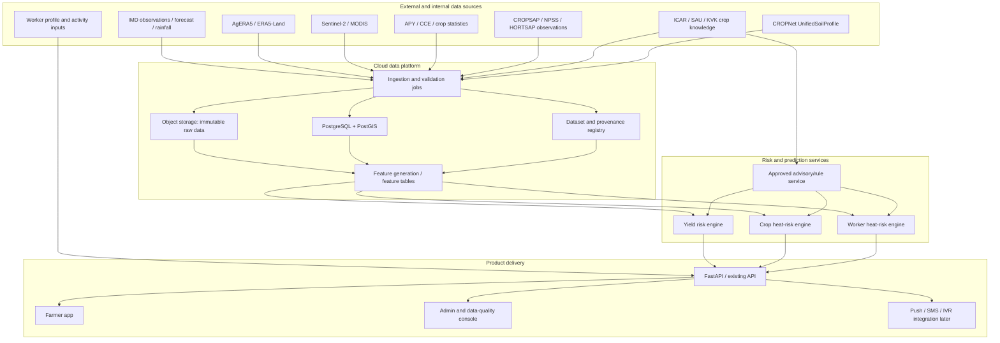

# Rashkar — Yield Intelligence & Heat-Risk Intelligence

## Engineering Blueprint, Product Scope, Architecture and Build Sequence

**Document status:** Proposed engineering specification for planning  
**Prepared:** 7 November 2026  
**Product:** Rashkar — cloud-based, software-only climate-smart agriculture platform for India  
**Initial geography:** Maharashtra, with a four-taluka soil integration pilot in Pune district where CropNet soil coverage is available  
**Priority features:** (1) Yield Intelligence, (2) Heat-Risk Intelligence  
**Out of scope for this phase:** Income Diversification / side-income recommendations and the multilingual conversational assistant. Those are intentionally deferred until the two priority features have functioning data foundations and validated first releases.

> **Implementation rule:** This is the product/technical target, not permission to rewrite an existing repository. Before implementation, inspect the actual repository, identify its current stack and architecture, and produce a repository-specific execution plan. Do not change application code until the owner explicitly approves that plan.

---

## 1. Product vision and operating principles

Rashkar should help a farmer understand what may happen to their crop and workers under changing weather and field conditions, why a risk is present, and what practical action is appropriate. It is not merely a weather display or a generic crop-advisory app.

### 1.1 Non-negotiable principles

1. **Cloud-only, software-only farmer experience.** Do not require IoT devices, wearables, local gateways, edge computers or farmer-purchased sensors. External research partners may take reference WBGT or field measurements to validate the software, but those measurements must not become a required farmer-side product dependency.
2. **Maharashtra-wide crop ambition.** Design the crop catalogue and interfaces for all major crops grown in Maharashtra, not cotton alone. The first calibrated models may cover a smaller subset where reliable labels exist. Unsupported crop/region combinations must be shown as limited-coverage or rule-based, not silently represented as validated ML predictions.
3. **Use CropNet for soil.** CropNet's `UnifiedSoilProfile` is the upstream soil-intelligence provider. Rashkar should consume its versioned output through a defined integration contract and must not build a duplicate soil extraction pipeline.
4. **Evidence before prediction.** Keep historical statistics, gridded estimates, forecasts, farmer-provided facts, laboratory measurements and verified field observations distinct. Never relabel an estimate as a measurement.
5. **Separate risk dimensions.** Weather, soil/water, crop-stage, pest, disease, crop-heat and worker-heat risks are distinct outputs. Do not collapse them into one opaque score until each component has been validated and a composite score has a defensible calibration method.
6. **No fabricated agronomy.** Thresholds, spray advice, fertilizer rates and work-rest guidance must come from traceable, current and crop/region-relevant institutional evidence. The model must not autonomously invent pesticide or fertilizer prescriptions.
7. **Confidence is first-class.** Every prediction should carry source provenance, spatial/temporal resolution, data freshness, missingness and confidence/coverage information.
8. **Farmer-first interface.** Large tap targets, minimal text, icon-led cards, simple labels, regional-language readiness, audio-ready advisory content, low-bandwidth behaviour and saved farm information. Do not make a long technical form the entry point.
9. **Human escalation.** High-impact or uncertain conditions should encourage confirmation with a KVK/agriculture officer/qualified professional. Heat messages should be precautionary and not represented as a medical diagnosis.
10. **Privacy by design.** Collect only worker/farmer attributes necessary for risk estimation. Use consent, role-based access, retention rules and de-identification for research datasets.

### 1.2 Initial geography and coverage policy

- The first product/data foundation is Maharashtra statewide.
- CropNet's current soil pilot context covers Baramati, Indapur, Maval and Mulshi in Pune district. Do not imply that this pilot provides verified soil measurements for all Maharashtra farms.
- Use the four talukas to test spatial representativeness and differences between plain/scarcity and Western Ghats transition environments.
- Keep the crop catalogue broad from the beginning: cereals/millets, pulses, oilseeds, fibre/commercial crops, horticulture, vegetables and spices.
- Maintain a **coverage matrix** by crop × district/taluka × season × risk component. It must show whether each result is model-backed, rule-backed, regional-only or unavailable.

---

## 2. Feature One — Yield Intelligence

### 2.1 Purpose

Estimate the risks that may reduce a farmer's crop performance and help the farmer understand the factors contributing to that risk. Later, where plot-level yield labels are sufficient, add a numeric yield forecast with uncertainty. The first release should prioritise transparent risk assessment over unvalidated numeric yield promises.

### 2.2 Feature scope

The feature consists of independently testable components:

1. Weather and climate risk.
2. Soil and water risk, using CropNet's `UnifiedSoilProfile`.
3. Crop-stage and crop-calendar assessment.
4. Pest risk.
5. Disease risk.
6. Crop condition / satellite indicators (progressively introduced).
7. Yield baseline and, later, validated yield estimation.
8. Evidence-based action/advisory mapping.

### 2.3 Farmer inputs and profile

Collect progressively, not as one large form.

**Required to create a useful crop cycle:**
- Farm identity and approximate location (GPS, selected village or map pin).
- Crop.
- Sowing/transplanting date, if known.
- Irrigation type or rainfed status, if known.

**Useful optional inputs:**
- Plot boundary (GeoJSON/polygon or map-drawn boundary).
- Variety/hybrid.
- Crop establishment method.
- Current crop stage, farmer-confirmed where possible.
- Irrigation source and reliability.
- Soil Health Card/lab result (only if the farmer has one).
- Previous harvest information.
- Field observations and optional crop photographs.

If the farmer does not know a field, allow “not sure”. A crop calendar may provide a provisional stage estimate, but it must be labelled estimated and the farmer should be able to correct it. Do not force a Soil Health Card upload.

### 2.4 Risk components and technical approach

#### A. Weather and climate risk

Inputs:
- AgERA5 daily historical indicators.
- ERA5-Land hourly historical data where hourly resolution is needed.
- IMD gridded rainfall for Indian rainfall history and comparison.
- IMD observations, forecasts, warnings and agromet advisories for current operations.
- Optional supplementary forecast data only after validation.

Initial derived features:
- Rolling rainfall totals over 3, 7, 14 and 30 days.
- Consecutive dry days using a documented rainfall threshold.
- Rainfall anomaly relative to an appropriate historical baseline and season window.
- Heavy-rain days and cumulative rainfall around sensitive stages.
- Daily maximum/minimum temperature and warm-night counts.
- Heat degree-days or crop-threshold exceedance days where an authoritative threshold exists.
- Relative humidity, vapour pressure deficit, solar radiation, wind and reference ET0.
- Forecast rainfall and temperature over the provider's actual forecast horizon.

Risk dimensions:
- Drought / dry-spell exposure.
- Excess rainfall / waterlogging potential.
- Heat stress.
- Cold stress where relevant to a crop and season.
- Wind / storm exposure where relevant.

Use source-specific timestamps, local-time conversion rules, forecast lead time and quality flags. Do not treat reanalysis as a direct farm observation. Do not merge IMD and reanalysis rainfall as duplicate rainfall events.

**First implementation:** transparent agronomic rules plus calibrated baselines. Train a supervised classifier only when labels and validation design are adequate.

#### B. Soil and water risk (CropNet integration)

Consume CropNet's `UnifiedSoilProfile` through an API/service contract. Expected fields may include:
- pH and depth interval.
- Soil organic carbon and depth interval.
- Sand, silt and clay percentages.
- USDA texture class.
- CEC.
- Total nitrogen.
- Per-parameter source, source version/vintage, spatial resolution, depth, verification status, coverage and uncertainty where available.
- Farm polygon coverage and mapped soil zones.

Explicitly distinguish:
- Total nitrogen from plant-available mineral nitrogen.
- Map-derived estimate from laboratory-verified value.
- Soil pH from electrical conductivity (EC).
- Texture-derived drainage tendency from actual measured drainage.
- Soil texture from taxonomic soil classification (e.g. USDA texture class versus Vertisol soil order).

The current CropNet profile described by the team does **not** guarantee available N, available P, available K, EC, soil depth to bedrock, drainage class or plant-available water capacity. If absent, keep them `NOT_AVAILABLE`; do not infer them from unrelated variables.

Rashkar should derive cautious indicators such as:
- Potential drought vulnerability using texture, organic carbon, weather and irrigation context.
- Potential waterlogging susceptibility using texture, rainfall, slope/topography and drainage information where available.
- Potential pH constraint against crop-specific approved reference ranges.
- Broad nutrient-retention context using CEC.

Do not give precise fertilizer quantities from total N or map-only data. Fertilizer guidance requires valid available-NPK lab values, crop recommendations and local agronomic review.

#### C. Crop stage and crop calendar

Use MIRCA-OS/UPAg/local university crop calendars as broad priors only. The farmer's actual sowing date and variety (if supplied) should take precedence. Build a canonical crop-stage table with:
- Crop and variety/hybrid (where supported).
- Stage code and stage name.
- Typical stage date range/duration.
- Stage-specific sensitivity to heat, water deficit, excess rain and pests/disease.
- Source and evidence citation.
- Maharashtra region/zone applicability.

Do not infer precise phenology from month alone where sowing date or variety information is missing. Return estimated stage and confidence.

#### D. Pest and disease risk

Maintain two separate data assets:

1. **Knowledge base:** crop, pest/disease, scientific/common name, symptoms, affected stage, favourable weather conditions, surveillance method, source, recommended management and source validity date.
2. **Observation dataset:** dated and geolocated observations with crop, crop stage, pest/disease identification, incidence/severity, survey method, evidence, source and verification status.

Potential sources include CROPSAP, HORTSAP, NPSS and Bhuvan Pest and Disease Surveillance. Bulk access is not confirmed. Request structured historical observations from relevant authorities and institutions.

Until adequate observation labels are available, produce a **weather-conditioned advisory/watch signal**, not a trained probability claim. Distinguish no observation from an explicit negative survey. Keep image-based disease/pest identification separate from village-level outbreak risk.

#### E. Satellite crop-condition indicators

Use Sentinel-2 for plot-scale vegetation time series where cloud-free imagery is available. Derive NDVI/EVI/NDMI only with quality masks and documented bands/formulas. MODIS products may supplement longer regional histories. Satellite indices are signals of vegetation condition, not proof of a particular pest, disease or crop-loss cause.

#### F. Yield baseline and numeric yield prediction

Stage 1:
- Clean APY data.
- Calculate district × crop × season × year yield baselines and trends.
- Keep area, production and yield units consistent.
- Record district boundary/version changes and crop name aliases.
- Use district-level models only for district-level outcomes.

Stage 2:
- Obtain CCE/DGCES records or independently collected plot-level harvest records.
- Link plot/season/crop, weather, soil, management and harvest outcome when permitted.
- Only train a farm/plot yield model when adequate representative labels exist.
- Show prediction interval/uncertainty and the training coverage.

Do not train farm-level yield claims using only district APY data. Do not duplicate rows from APY dataset mirrors or crop-specific extracts.

### 2.5 Yield Intelligence outputs

Suggested response shape (adapt to existing API conventions):

```json
{
  "farm_id": "farm_123",
  "crop_cycle_id": "cycle_456",
  "generated_at": "ISO-8601 timestamp",
  "coverage": {
    "crop": "supported | limited | unsupported",
    "geography": "supported | regional_only | unsupported",
    "data_completeness": 0.0,
    "confidence": "low | medium | high"
  },
  "crop_stage": {
    "stage_code": "flowering",
    "stage_source": "farmer_confirmed | sowing_date_estimate | calendar_estimate",
    "confidence": "low | medium | high"
  },
  "risks": [
    {
      "risk_type": "dry_spell | excess_rain | heat | soil | pest | disease",
      "risk_level": "low | moderate | high | very_high | insufficient_data",
      "time_horizon": "explicit interval",
      "likelihood": null,
      "impact": "low | moderate | high | unknown",
      "confidence": "low | medium | high",
      "drivers": [],
      "evidence": [],
      "actions": []
    }
  ],
  "yield_estimate": {
    "status": "not_available | regional_baseline | model_estimate",
    "value": null,
    "unit": "tonnes_per_hectare",
    "prediction_interval": null,
    "geographical_level": "district | plot",
    "model_version": null
  }
}
```

The example is a proposal, not an existing API schema. Do not return a fabricated number when `status` is `not_available`.

### 2.6 Farmer-facing screens

1. **My farm:** list farm/plot, crop, sowing date and simple status.
2. **Crop risk overview:** 3–5 clear cards (Weather, Soil/Water, Pest, Disease, Crop stage), with a plain-language severity and date range.
3. **Risk detail:** what is happening, why Rashkar thinks so, expected time window, confidence and source freshness.
4. **What to do:** actions approved by ICAR/SAU/KVK source material, with “ask an expert” option for uncertain or high-impact issues.
5. **Report what you see:** optional field observation/photos with consent and location confirmation; clearly label farmer-reported versus expert verified.

Do not show the model's internal raw probabilities as if they were certainty. Explain “high risk” in farmer language and keep uncertainty visible.

---

## 3. Feature Two — Heat-Risk Intelligence

### 3.1 Purpose

Provide advance warning of heat-related risk to (a) agricultural workers performing outdoor work and (b) crops exposed to heat during sensitive growth stages. These are two different risk pathways and must not be collapsed into one model.

### 3.2 Worker heat-risk pathway

**Initial operating target:** 0–6 hour forward-looking risk window, with risk recalculation targeted at 30-minute intervals when new inputs or updated forecasts are available. A 30-minute recalculation schedule does not mean that IMD or another source supplies a new observation every 30 minutes.

#### Inputs

Environmental:
- Air temperature.
- Relative humidity or dewpoint-derived humidity.
- Wind speed.
- Solar radiation / cloud cover / radiant-heat proxy.
- Pressure/altitude where needed by the selected method.
- Forecast lead time and timestamp.
- Land-cover/terrain context where it improves exposure estimation.

Worker/activity context, collected minimally and optionally:
- Work task/intensity category.
- Planned start/end time or work window.
- Sun/shade conditions.
- Clothing category where justified by the method.
- Acclimatisation status (simple user-friendly question).
- Rest/shade/water access, if used by the chosen risk method.
- Optional broad age band only if justified, lawful and privacy reviewed.

Do not collect detailed health diagnoses or sensitive medical history for a first release. Do not represent the result as a diagnosis or individual probability of heatstroke.

#### WBGT / thermal hazard calculation

- Implement a scientifically documented outdoor WBGT estimation approach based on the required meteorological inputs, including radiant heat and wind.
- Do not calculate a purported WBGT from temperature and relative humidity alone.
- Record every approximation (e.g. solar/radiant input, shade assumption, wind-height correction, missing data fallback).
- Call the output `estimated_wbgt` or `wbgt_proxy` unless directly measured with a validated instrument.
- Compare against measured WBGT during research validation in Maharashtra.
- Use UTCI/MRT as an independent thermal-comfort/context indicator, not as a WBGT substitute.

A formula/method should be selected during the execution-plan phase and approved by an occupational heat/thermal-comfort expert. The implementation must cite the source and applicable standard. Do not invent numeric work-rest thresholds. Thresholds depend on workload, acclimatisation, clothing and relevant standard guidance.

#### Worker risk engine

Initial version:
1. Calculate local heat-hazard indicators for the next 0–6 hours from forecast/reanalysis/observations.
2. Estimate exposure based on time, sun/shade and task/workload.
3. Apply source-backed occupational guidance using workload/acclimatisation categories.
4. Return a transparent risk band and the factors driving it.
5. Trigger a precautionary message and approved action when conditions warrant.

Later, once an appropriately consented and representative outcome dataset exists, evaluate supervised models. XGBoost/Random Forest are candidate baselines, not a predetermined requirement. Do not claim individual clinical prediction without appropriate outcomes, validation and expert oversight.

Output:
- Hazard estimate and its method.
- Forecast window and data freshness.
- Worker/activity context used.
- Risk band, confidence and missing inputs.
- Action text/source.
- Explicit caveat that it is a decision-support alert, not a medical diagnosis.

### 3.3 Crop heat-risk pathway

Inputs:
- Same shared weather pipeline.
- Crop and crop stage.
- Crop/variety where known.
- Sowing date and location.
- Crop-specific heat sensitivity thresholds from ICAR/SAU/commodity institutes.
- Soil/water/irrigation context from CropNet and farmer profile.

Derived indicators:
- Maximum and minimum temperature during sensitive stages.
- Day/night heat exposure.
- Duration and recurrence of temperature threshold exceedances.
- Vapour pressure deficit and ET0 as atmospheric-demand context.
- Solar radiation and wind context.
- Soil moisture/water availability proxies where defensible.

A crop-specific threshold record must include crop, variety if relevant, phenological stage, variable, threshold, required exposure duration, source, source date, geography and evidence grade. No universal threshold should be applied to every crop.

### 3.4 Heat-risk outputs

Separate API/resources for worker and crop risk:

- `worker_heat_risk`: estimated thermal hazard, activity-adjusted band, window, confidence, actions and caveat.
- `crop_heat_risk`: crop-stage-specific heat exposure, sensitivity, window, confidence and approved agronomic actions.

Do not create a single “heat score” that mixes worker health risk and crop damage risk.

### 3.5 Heat-risk farmer-facing flow

1. User opens “Heat Safety” or the relevant farm/crop section.
2. Show today's local heat outlook and affected hours.
3. Worker path: ask only the activity details needed for the calculation; offer a simple “working in sun / shade” choice.
4. Crop path: choose registered farm/crop cycle; do not ask repeatedly for known details.
5. Show risk band, why it is elevated, when, and practical precautionary action.
6. Offer audio/vernacular-ready advisory text as a later presentation layer; the multilingual assistant itself is out of scope for this phase.

---

## 4. Recommended technology stack

**First rule:** Antigravity must inspect the existing Rashkar repository before choosing or changing technology. Reuse working components and match the current architecture. The list below is the recommended default for a new implementation, not a mandate to rewrite an existing stack.

### 4.1 Recommended default

| Layer | Recommended technology | Why |
|---|---|---|
| Farmer mobile app | Flutter / Dart | Android-first, cross-platform, offline-friendly UI and regional-language support |
| Admin/data operations web app | Next.js + TypeScript | Dataset operations, access review, model/risk monitoring and pilot administration |
| API backend | Python FastAPI + Pydantic | Typed service contracts and natural integration with data/ML stack |
| Primary database | PostgreSQL | Farm, crop-cycle, user, result and reference data |
| Geospatial database | PostGIS extension | Plot polygons, spatial joins, point/grid extraction and administrative boundaries |
| Time-series storage | PostgreSQL partitioning initially; TimescaleDB only if justified | Avoid adding time-series infrastructure before actual load requires it |
| Object storage | S3-compatible storage (cloud object storage; MinIO for local development) | NetCDF, GeoTIFF, Parquet, images, PDFs and model artefacts |
| Data processing | Python, Pandas or Polars, Xarray, Dask, GeoPandas, Rasterio/rioxarray, Shapely, PyProj, PyArrow | Tabular, gridded weather and geospatial pipelines |
| ML baselines | scikit-learn, XGBoost / LightGBM / CatBoost only where justified | Transparent baselines and tabular models |
| Image models (optional later) | PyTorch / torchvision | Crop image classification when data, licensing and field validation are adequate |
| Model tracking | MLflow | Dataset/model versions, metrics, artefacts and reproducibility |
| Batch orchestration | Prefect or an existing orchestration tool | Scheduled weather downloads, feature generation and retraining |
| Background jobs/cache | Redis with existing worker framework if required | Short-lived cache and asynchronous tasks; avoid redundant queue systems |
| Data quality | Pandera or Great Expectations; pytest | Schema and range checks, regression tests and reproducible validations |
| API/database migrations | SQLAlchemy + Alembic, if consistent with current project | Versioned data model evolution |
| Containers | Docker | Reproducible development and deployment |
| Observability | Structured logs, OpenTelemetry, error monitoring and metrics | Data freshness, API health, model health and auditability |

### 4.2 Cloud architecture

- Deploy backend and workers as managed containers.
- Use managed PostgreSQL with PostGIS in production.
- Use cloud object storage for immutable raw files and processed partitions.
- Store secrets in the cloud secret manager; never commit API keys, passwords, tokens or user data.
- Run batch data ingestion separately from latency-sensitive farmer API requests.
- Cache farm-level risk results with clear expiry and source-freshness metadata.
- Add monitoring for missing data, stale forecast inputs, pipeline failures, model drift and API errors.
- Keep all core calculations and data access in cloud services; do not require an on-farm device.

### 4.3 Architecture diagram



---

## 5. Canonical data model and integration contracts

Antigravity must compare these proposed entities with existing schemas and reuse/extend existing models instead of creating duplicate tables.

### 5.1 Core entities

- `farms`: owner/account reference, display name, location, centroid, district/taluka/village codes.
- `farm_plots`: farm ID, polygon geometry, area, boundary source/accuracy, geometry version.
- `crop_cycles`: plot ID, crop code, variety, season, sowing/transplant date, irrigation status, current stage and source of stage.
- `dataset_registry`: dataset ID, publisher, source URL, access mode, licence, version/vintage, download date, temporal/spatial coverage, checksum, data dictionary and limitations.
- `weather_observations`: source, grid/station ID, timestamp, variable, value, unit, quality flag, spatial geometry/grid reference.
- `weather_forecasts`: provider, issue time, valid time, lead time, location/grid, variable, value, unit and forecast run ID.
- `soil_profile_snapshots`: CropNet profile ID/version, farm/plot reference, parameters, source provenance, depth, uncertainty, coverage, verification status and retrieval time. Preserve the upstream representation or a validated snapshot; do not mutate CropNet values silently.
- `crop_stage_reference`: crop, variety, stage, expected timing, source and applicability.
- `crop_threshold_reference`: crop, stage, variable, threshold, exposure duration, source, evidence grade and region.
- `pest_disease_observations`: event date, location, crop, stage, pest/disease, severity/incidence, survey method, evidence and verification.
- `yield_observations`: crop/plot/season, harvest area, yield, measurement method, moisture basis, source and verification.
- `worker_activity_context`: pseudonymous worker/session ID, time window, activity/workload, sun/shade and other consented fields.
- `risk_assessments`: farm/plot or worker context, risk type, time horizon, model/rule version, score/band, confidence, source run IDs and explanation.
- `advisory_catalogue`: approved action, crop/risk/stage applicability, source, version and review date.

### 5.2 Provenance fields required for every external observation

At minimum:
- `source_id` and `source_name`.
- `source_url` or source document reference.
- `source_version` / dataset vintage.
- `downloaded_at` / retrieved_at.
- `observed_at` or forecast issue/valid times.
- `spatial_resolution_m` or grid geometry/station metadata.
- `depth_interval` for soil data.
- `unit` and conversion method.
- `quality_flag` / verification status.
- `processing_version` and checksum where appropriate.

### 5.3 CropNet integration contract

Proposed only. The CropNet team must confirm the actual API, schema, auth and version semantics.

Required behaviour:
- Retrieve profile by stable farm/plot reference and request correlation ID.
- Preserve each parameter's value, unit, depth, source, vintage, spatial resolution, verification status, coverage and uncertainty if available.
- Treat missing parameters as unavailable, not zero.
- Do not infer EC from pH, available NPK from total nitrogen, soil depth from texture, or water-holding capacity from clay percentage alone.
- Record when CropNet profile was last refreshed.
- Allow the farmer to upload an optional Soil Health Card through CropNet's supported workflow; Rashkar should consume the resulting laboratory-verified fields if provided.
- Do not create a second OCR or soil-raster pipeline inside Yield Intelligence unless an explicit integration requirement is approved.

---

## 6. Proposed API surface

Adapt names and conventions to the existing application. Do not implement these blindly if equivalent endpoints already exist.

- `GET /v1/farms/{farm_id}` — farm summary and plot references.
- `GET /v1/farms/{farm_id}/crop-cycles` — active and historical crop cycles.
- `POST /v1/farms/{farm_id}/crop-cycles` — create/update a crop cycle.
- `GET /v1/farms/{farm_id}/soil-profile` — pass through or return latest CropNet profile snapshot and provenance.
- `GET /v1/farms/{farm_id}/yield-risk` — component risks and current evidence.
- `GET /v1/farms/{farm_id}/yield-risk/history` — historical risk assessments.
- `GET /v1/farms/{farm_id}/crop-heat-risk` — crop-specific heat exposure/risk.
- `POST /v1/worker-heat-risk/assess` — assessment for a chosen work window and activity context.
- `GET /v1/worker-heat-risk/{assessment_id}` — retrieve assessment.
- `POST /v1/field-observations` — farmer-reported pest/disease/crop-condition event (unverified initially).
- `GET /v1/coverage` — crop/geography/model coverage matrix.

API requirements:
- Pydantic schemas and explicit units/enums.
- Request correlation IDs, authentication and role-based authorisation.
- Rate limiting and input validation.
- Clear `insufficient_data` responses instead of fabricated outputs.
- No raw personal/worker data in logs.
- Idempotency for ingestion and assessment-trigger actions where relevant.

---

## 7. Exact implementation sequence

The steps below are the intended development sequence. Antigravity must first translate them into actual repository file changes and milestones in an execution-plan document.

### Phase 0 — Repository discovery and planning (no implementation changes)

1. Inspect repository tree, README, package manifests, requirements/lock files, Docker files, environment examples, CI, database migrations and existing API/UI structure.
2. Identify current framework, language, runtime, database, auth, cloud deployment and testing conventions.
3. Search for existing farm, plot, weather, soil, prediction, crop and notification modules.
4. Inspect CropNet integration boundaries or existing schemas if available. Do not assume local paths referenced in another teammate's machine exist in this repository.
5. Identify duplicate services, existing APIs and current code quality risks.
6. Map this blueprint onto the existing structure. Reuse components and minimise new dependencies.
7. Produce `docs/EXECUTION_PLAN.md` with exact files/modules to add or change, architecture diagram, migration plan, dependency decisions, data-acquisition tasks, commands, tests, risks and acceptance gates.
8. STOP. Wait for explicit written approval before editing code or infrastructure.

### Phase 1 — Data contracts and registry

1. Create/confirm canonical crop codes, season codes, district/taluka codes and unit conventions.
2. Create dataset registry schema and `data/README` or equivalent metadata convention.
3. Define raw/processed/feature/label storage zones.
4. Create data dictionaries and versioned source manifests.
5. Add validation for duplicate rows, impossible values, missingness, time zones, CRS, geometry validity and unit conversion.
6. Add data access and licence notes; prohibit committing restricted datasets or credentials.
7. Write tests for schemas and source adapters.

### Phase 2 — Shared geospatial and weather pipeline

1. Establish Maharashtra district/taluka boundaries and CRS policy (store geospatial geometry in an appropriate projected/standard CRS and preserve source CRS metadata).
2. Ingest AgERA5 v2 data for a bounded pilot period and a set of Maharashtra grid cells/locations before expanding statewide.
3. Ingest IMD rainfall history for the selected period; parse NetCDF metadata and convert units explicitly.
4. Ingest ERA5-Land hourly data needed for thermal calculations and selected soil-water variables.
5. Set up IMD API client for observations, warnings, forecasts and agromet advisories; store provider issue time, observed time, valid time and access response metadata.
6. Add optional NOAA GFS adapter only after confirming operational need, licensing and local validation.
7. Standardise to canonical daily/hourly tables or Parquet partitions; maintain source-specific values.
8. Implement spatial extraction for plot polygon or centroid, including weighted/area coverage and a resolution caveat.
9. Calculate daily weather features and data-freshness status.
10. Add automated pipeline tests and sample reproducibility report.

### Phase 3 — Crop catalogue, calendar and crop knowledge

1. Create canonical crop master for major Maharashtra crops and their aliases.
2. Map APY crop labels to canonical crop codes; retain original labels.
3. Import MIRCA-OS calendars as broad priors and record its 5-arc-minute limitations and year snapshots.
4. Add UPAg/SAU/ICAR/IMD crop calendar references after manual source review.
5. Structure crop stage durations and sensitivities by crop/variety/region with source citations.
6. Build advisory records with crop, region, stage, risk, action, contraindication/conditions, source and validity dates.
7. Add expert review workflow for sensitive recommendations.
8. Test that no unsupported crop-stage rule is returned as verified.

### Phase 4 — Yield Intelligence v1 (rules and baselines)

1. Clean APY, deduplicate mirrored datasets and validate area/production/yield arithmetic.
2. Build district × crop × season baseline tables and visual/statistical QA.
3. Join crop cycle with weather by date and spatial index.
4. Integrate CropNet soil profile; preserve per-parameter metadata, nulls, uncertainty and status.
5. Implement weather rules for dry spell, rainfall excess and crop-stage heat using source-backed thresholds.
6. Implement soil constraint rules using only available and suitable CropNet parameters.
7. Implement crop-stage estimation with farmer confirmation precedence.
8. Implement pest/disease advisory-watch rules only from approved knowledge and current observations; display the data limitation.
9. Add component risk output, confidence, source evidence and `insufficient_data` handling.
10. Build API and farmer UI cards/details.
11. Validate with agronomists/KVK/SAU participants in pilot areas.
12. Do not enable plot-level yield ML until sufficient CCE/field yield data exists.

### Phase 5 — Heat-Risk v1 (hazard calculation and transparent rules)

1. Select the worker thermal-hazard method with a qualified reviewer; document formula, variables, assumptions and applicable standards.
2. Implement hourly input assembly using ERA5-Land history for backtesting and IMD/GFS operational forecast/observation inputs for current use.
3. Implement a clearly named estimated WBGT/WBGT proxy only if the method and inputs support it; never label UTCI as WBGT.
4. Implement UTCI/MRT as separate context/benchmark indicators where available.
5. Define activity/workload categories and approved occupational guidance with source, version and applicability.
6. Implement 0–6-hour worker heat-risk assessments; record forecast issue time and valid time.
7. Implement separate crop heat-risk calculation with crop-stage-specific evidence-backed thresholds.
8. Implement risk recalculation target at 30-minute intervals only when inputs permit; display data age and provider timestamp.
9. Add simple worker and crop heat-risk UI.
10. Validate calculations against a reference implementation and partner-measured WBGT during a research pilot.
11. Do not claim clinical diagnosis, heatstroke probability or proven reduction in heat illness.

### Phase 6 — Label acquisition and ML readiness

1. Request CCE/DGCES records from relevant Maharashtra authorities.
2. Request CROPSAP/HORTSAP/NPSS/Bhuvan historical pest/disease observations with data dictionary and licence.
3. Request access to relevant worker WBGT/exposure study data and arrange Maharashtra research-partner measurements.
4. Create field-label ingestion templates and verification states.
5. Assess coverage, selection bias, class balance, missingness and label quality.
6. Define temporal and spatial train/validation/test splits before training.
7. Establish baseline models and compare against rules.
8. Train ML only for crop/risk combinations with adequate representative labels.
9. Track experiments and artefacts in MLflow (or the existing equivalent).
10. Calibrate probabilities and test subgroup/location performance.
11. Publish coverage and limitations alongside model versions.

### Phase 7 — Satellite and plot-level refinements

1. Implement Sentinel-2 retrieval for registered pilot plots, with cloud/quality masks.
2. Generate NDVI/EVI/NDMI time series and preserve all source dates and band formulas.
3. Add MODIS regional comparison if it provides value.
4. Compare derived indicators with crop stage and field observations.
5. Never interpret NDVI decline alone as a specific disease, pest or percentage crop loss.

### Phase 8 — Production readiness and pilot

1. Complete threat model, privacy review, permissions and retention policy.
2. Add API auth, rate limits, error handling and audit logs.
3. Add pipeline observability, provider freshness alerts and model monitoring.
4. Run load tests and data recovery tests.
5. Complete farmer usability testing with low-literacy users and Marathi/Hindi-speaking participants; language assistant remains out of scope, but UI string localisation should be architected cleanly.
6. Conduct expert review of high-impact actions.
7. Roll out to a controlled pilot; compare forecasts with observed events and collect feedback.
8. Create model/data release notes and rollback process.

---

## 8. Model validation and acceptance criteria

### 8.1 General validation rules

- Split by time and geography. Prefer holdout seasons/years and holdout districts or talukas to test generalisation.
- Avoid spatial/temporal leakage from the same plot, district-year or repeated observation appearing in both training and test sets.
- Do not use future information in features for past predictions.
- Record all data imputation and missing-value methods.
- Preserve a no-model rules baseline for comparison.
- Report performance by crop, season, district/zone and risk type, not only one overall average.
- Calibrate predicted probabilities before presenting them as probabilities.
- Evaluate model coverage and confidence as well as discrimination/error.

### 8.2 Yield component metrics

For classification/risk:
- Precision, recall, F1.
- PR-AUC for imbalanced events.
- Calibration/Brier score where probability output is used.
- False-alert rate and missed-event rate.

For numeric yield:
- MAE, RMSE and R², with crop- and region-specific breakdowns.
- Prediction interval coverage and width.
- Comparison against district historical baseline and simple crop/season averages.

### 8.3 Heat component metrics

For thermal hazard estimation:
- MAE/RMSE and bias against measured WBGT reference observations, with time-of-day and shade/sun subgroup analysis.
- Agreement in risk categories and threshold crossings.
- Error by terrain/land-cover/weather regime.

For worker outcomes (only if collected with ethical approval and adequate labels):
- Sensitivity/recall for agreed outcomes, false alert rate, calibration and subgroup evaluation.
- Do not infer medical performance from UTCI correlation alone.

### 8.4 Release acceptance checklist

A feature is not production-ready unless:
- All shown data have traceable source and timestamp.
- Units and depth/time semantics are explicit.
- `NOT_AVAILABLE` is preserved as missing, not zero.
- The feature has an `insufficient_data` path.
- Crop/geography/model coverage is disclosed.
- Rule/model version is recorded per assessment.
- Risk components have an expert-reviewed explanation and action source.
- Time-based and spatial validation has been documented.
- Farmer UI has passed pilot usability tests.
- No unsupported claims of farm-level accuracy, health diagnosis, or guaranteed yield improvement are made.

---

## 9. Security, privacy, licensing and operational safeguards

1. Do not commit source data that is licensed, restricted, personal or subject to institutional access conditions.
2. Store API keys and tokens only in a secret manager/environment injection. Never store in Markdown, Git or logs.
3. Respect each dataset's licence and attribution requirement; maintain a per-file licence register.
4. Keep user-submitted farm boundaries and worker information access-controlled.
5. De-identify field and worker validation records before research sharing.
6. Add consent wording and purpose limitation for any worker or symptom-related information.
7. Set retention and deletion policies with the product/legal owner.
8. Add provenance and audit trails so a farmer-facing alert can be traced to input data and rule/model version.
9. Make external service failures visible as stale/missing input rather than quietly reusing old data without a warning.
10. Have a safe fallback: if forecast, soil or model data are unavailable, show approved general precautionary guidance and identify the limitation.

---

## 10. Explicitly out of scope for this phase

- Income Diversification / side-income recommendations.
- Multilingual conversational assistant / voice AI.
- PMFBY crop-loss verification.
- Automated pesticide/fertilizer prescriptions without adequate lab and expert evidence.
- Mandatory farmer-owned sensors, wearables or IoT devices.
- Automatic official insurance decisions.
- Claims that Rashkar prevents heat illness, guarantees yields or proves disease/crop loss from satellite imagery alone.

---

## 11. Decisions required from the repository-specific execution plan

Antigravity's `docs/EXECUTION_PLAN.md` must explicitly answer:

1. What stack and modules already exist? What will be reused?
2. What new dependencies are actually necessary, and why?
3. What are the precise file/module changes for each phase?
4. How will CropNet `UnifiedSoilProfile` be called, authenticated, versioned and cached?
5. Which datasets can be downloaded immediately, which require accounts/API keys, and which require institutional access requests?
6. What is the initial crop/geography coverage matrix?
7. Which risk components can be rule-based in v1, and which must be held back for lack of labels?
8. What is the proposed WBGT estimation method and expert-review requirement?
9. What database migrations and data retention changes are required?
10. How will tests, backfills, observability, security and rollback work?
11. What is the smallest safe, demonstrable milestone for each feature?
12. What decisions or credentials/data access are needed from the owner?

**No implementation work is authorised until this execution plan is reviewed and explicitly approved.**
