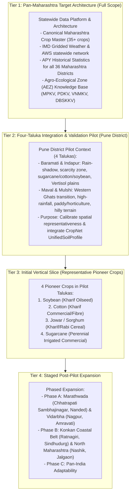
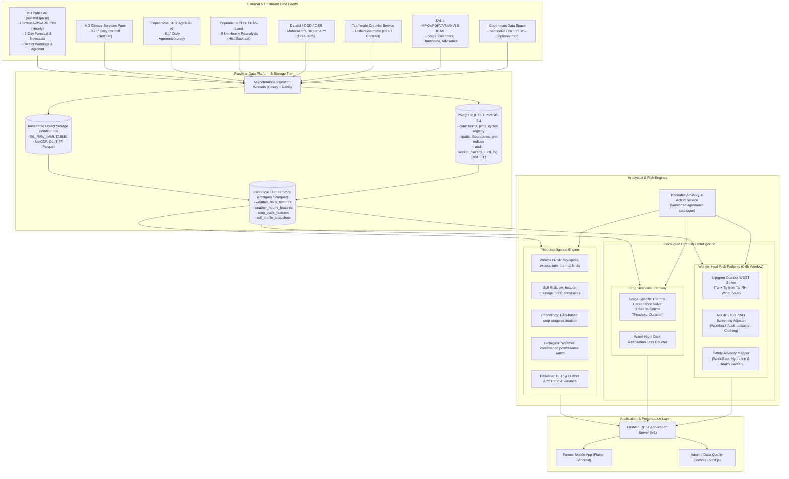
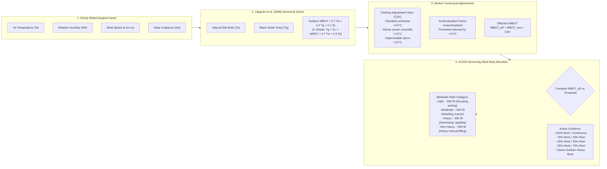
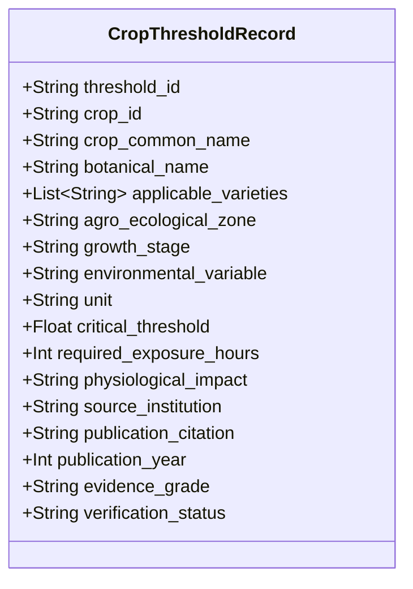
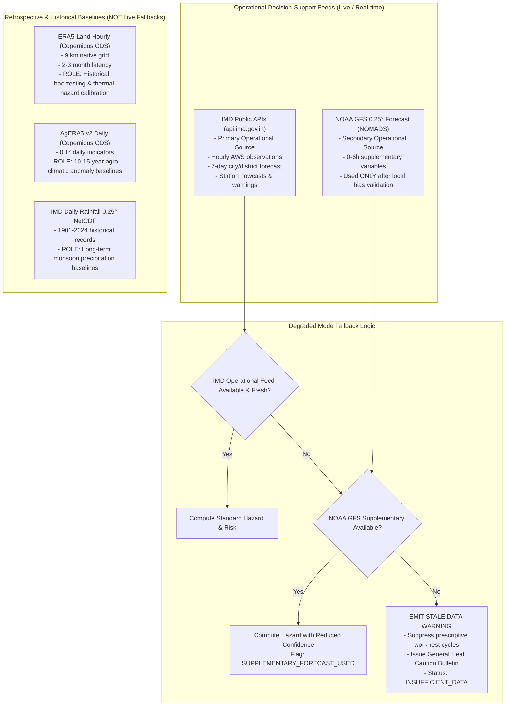

# Rashkar — Architectural Execution Plan & Implementation Blueprint

**Document Version:** 2.0.0-REVISED  
**Date:** 8 November 2026  
**Document Location:** `docs/EXECUTION_PLAN.md`  
**Target Geographical Scope:** Maharashtra Statewide Platform Architecture  
**Initial Validation & Integration Pilot:** Pune District (Four Talukas: Baramati, Indapur, Maval, Mulshi)  
**Priority Features:** (1) Yield Intelligence, (2) Heat-Risk Intelligence (Worker Heat Hazard & Crop Heat Stress)  
**Deferred Scope:** Income Diversification / Side-Income & Multilingual Conversational Voice Assistant  
**Status:** **PROPOSED REVISED PLAN — PENDING OWNER APPROVAL BEFORE ANY IMPLEMENTATION**  

---

## Executive Summary

Rashkar is a cloud-native, software-only, climate-smart agricultural decision-support platform designed for Maharashtra, India, with an architectural foundation intended for future expansion across India. Smallholder farmers operate under extreme climatic variability—from mid-season monsoon dry spells to scorching pre-monsoon heat waves. Rashkar equips farmers, agricultural managers, and extension officers with explainable, transparent, and scientifically anchored risk intelligence across two critical capabilities:
1. **Yield Intelligence:** Diagnosing and communicating meteorological, soil-water, phenological, and biological risks that threaten seasonal crop yield, paired with traceable, institutionally approved agronomic actions.
2. **Heat-Risk Intelligence:** A decoupled, two-pathway thermal safety engine computing:
   - **Agricultural Worker Heat Risk:** Near-term (0–6 hour) occupational thermal hazard assessments, estimating effective Wet Bulb Globe Temperature ($WBGT_{eff}$ proxy), activity-adjusted work-rest guidance, and hydration safety warnings.
   - **Crop Heat Risk:** Growth-stage-specific crop thermal stress assessments, evaluating high-temperature and warm-night exposure against evidence-backed physiological thresholds.

Following a thorough read-only repository audit and structural graph analysis with Graphify, this execution plan defines the end-to-end technical architecture, data provenance chains, integration contracts, validation protocols, and a dependency-aware phased implementation roadmap. 

> [!IMPORTANT]
> **GOVERNANCE & IMPLEMENTATION RESTRICTION:**  
> This revised document represents the definitive technical plan. In accordance with strict pair-programming governance, **no application code, configuration files, database schemas, migrations, dependencies, or external datasets have been modified or installed.** Implementation will commence **only after explicit written approval of this document by the repository owner.**

---

## A. Repository Audit & Technical Baseline

### A.1 Current Environment and Runtime Status
- **Host Operating System:** Windows 11 (PowerShell 5.1 / 7+ compatible)
- **Runtime Environment:** Python 3.13.x globally available (`C:\Program Files\Python313\python.exe`)
- **Version Control Status:** Clean directory (`D:\CSE AIML\Rashkar`). Git is not yet initialized in the local project directory.
- **Repository Nature:** **Greenfield project space.** No legacy codebase, obsolete ORM models, or deprecated configuration exists in the workspace.

### A.2 Inspected File Inventory
| File Path | Category | Purpose / Content Description |
|---|---|---|
| `D:\CSE AIML\Rashkar\01_Rashkar_Feature_Blueprint.md` | Specification | Product vision, architectural principles, core schemas, risk engine designs, and sequence. |
| `D:\CSE AIML\Rashkar\02_Rashkar_Dataset_Register_and_Usage.md` | Data Register | Complete inventory of 20+ datasets, licensing terms, URLs, variable lists, and access workflows. |
| `D:\CSE AIML\Rashkar\Yeild Risk.md` | Concept Note | Conceptual breakdown distinguishing Yield Risk Assessment vs. Yield Prediction vs. Improvement. |
| `D:\CSE AIML\Rashkar\graphify-out\graph.json` | Knowledge Graph | Graphify model of the specifications (149 nodes, 146 edges, 12 communities). |
| `D:\CSE AIML\Rashkar\graphify-out\GRAPH_REPORT.md` | Graph Audit | Audit report identifying central abstractions ("god nodes") and subsystem clustering. |
| `D:\CSE AIML\Rashkar\graphify-out\graph.html` | Visual Explorer | Visual interactive graph explorer showing specification relationships. |

### A.3 Existing Services, Models & Technical Debt Analysis
- **Backend / API Scaffolding:** None present. Must be built from scratch.
- **Database Schemas & Migrations:** No existing relational tables, PostGIS schemas, or Alembic migrations exist.
- **Automated Tests:** No existing test suite (`pytest`) or test fixtures.
- **Secrets & Configuration:** No `.env` files or credentials exist in the workspace.
- **CropNet Integration:** No code, mock stubs, or API schemas exist in the workspace. CropNet is teammate-owned and external.

### A.4 Graphify Structural Insights
Graphify analysis revealed five primary "god nodes" (central architectural hubs):
1. `Yield Intelligence Datasets` (19 connecting edges) — convergence of meteorological, statistical, and soil sources.
2. `Yield Risk Assessment Engine` (15 edges) — central business logic hub orchestrating multi-risk evaluation.
3. `Rashkar System Specification` (13 edges) — non-negotiable operating rules and governance.
4. `Heat-Risk Datasets & WBGT Methods` (10 edges) — thermal hazard pipelines and occupational guidelines.
5. `Phased Implementation Sequence` (10 edges) — milestone dependency chaining.

The system naturally decomposes into **12 decoupled communities**, validating our planned modular directory structure (isolating data ingestion, feature generation, risk reasoning, and API delivery).

---

## B. Scope Differentiation & Geographical Staging

A fundamental flaw in naive agricultural platform design is conflating a localized integration pilot with the intended geographic and agronomic scope of the product. Rashkar strictly separates these tiers:



### B.1 Distinguishing the Four Architectural Tiers
1. **Pan-Maharashtra Product Architecture & Crop Catalogue (Target Scope):**
   - The data models, API endpoints, crop master tables, and administrative boundaries are built from Day 1 to accommodate all **36 districts of Maharashtra** and **35+ major crops** (cereals, millets, pulses, oilseeds, commercial crops, vegetables, and fruit horticulture).
   - District APY historical baselines and IMD gridded meteorological pipelines cover the entire state.
2. **Four-Taluka Validation & Integration Pilot (Pune District):**
   - **Baramati and Indapur:** Characterized by the semi-arid, rain-shadow scarcity zone of Central Maharashtra, dominated by deep black cotton soils (Vertisols), extensive canal/well irrigation (sugarcane), and rainfed pulses/oilseeds.
   - **Maval and Mulshi:** Characterized by the high-rainfall Western Ghats (Sahyadri) transition zone, dominated by shallow gravelly/lateritic soils, terraced paddy cultivation, and heavy monsoon humidity.
   - **Purpose:** Testing spatial algorithms across contrasting agro-ecological regimes and serving as the physical boundary where upstream teammate CropNet soil data is currently available.
3. **First Representative Crops for the Initial Vertical Slice:**
   - **Soybean (*Glycine max*):** Primary Kharif oilseed, highly vulnerable to mid-season dry spells during flowering and pod development.
   - **Cotton (*Gossypium hirsutum*):** Primary commercial fibre crop, sensitive to waterlogging, boll shedding under high thermal heat (>38°C), and sucking pests.
   - **Jowar (*Sorghum bicolor*):** Staple dryland cereal, drought-hardy but sensitive to cold/wet conditions during maturity.
   - **Sugarcane (*Saccharum officinarum*):** Long-duration irrigated commercial crop, high water requirement, vulnerable to peak summer heat and water shortages.
4. **Subsequent Expansion Phases:**
   - Expansion to Vidarbha (cotton/soybean distress zones) and Marathwada (drought-prone pulse/oilseed zones) upon obtaining local CCE and CROPSAP records.
   - Eventual national expansion by swapping state administrative boundary packs and regional SAU knowledge tables.

---

## C. Definitive Technology Stack Decisions

To prevent technical drift and avoid building multiple redundant stacks, Rashkar selects **one definitive, production-grade technology for each layer**, with future alternatives documented strictly as reference:

| Architectural Layer | Selected Production Technology | Justification & Architectural Rationale | Future Alternative (Reference Only) |
|---|---|---|---|
| **Farmer Mobile Client** | **Flutter / Dart (v3.24+)** | Single cross-platform codebase; superior Android performance on low-end rural smartphones; native offline SQLite persistence; exceptional rendering of complex Indic typography (Marathi / Devanagari script). | React Native (PWA approach deferred) |
| **Admin & Data Console** | **Next.js 14+ (TypeScript)** | Server-side rendering (SSR) for dataset registry management, model evaluation dashboards, audit review, and spatial map overlays. | Retool or Streamlit (internal tools) |
| **API & Core Backend** | **FastAPI (Python 3.13)** | High-performance asynchronous REST framework; native Pydantic v2 data validation; seamless interoperability with Python scientific data stack (Pandas, Xarray, Scikit-learn). | Django REST Framework |
| **Primary Relational DB** | **PostgreSQL 16** | Robust ACID transactional semantics; enterprise-grade JSONB document querying; connection pooling; partitioned tables for time-series logs. | CockroachDB |
| **Spatial Engine** | **PostGIS 3.4 Extension** | Native spatial types (`GEOMETRY(Polygon, 4326)`), R-tree spatial indexing (`GIST`), spatial joins between farm boundaries and gridded weather rasters. | SpatiaLite (mobile-only) |
| **Object Storage** | **S3-Compatible Storage (MinIO dev / Cloud Object Storage prod)** | Write-Once-Read-Many (WORM) storage for raw gridded NetCDF files, GeoTIFF satellite tiles, and Parquet feature archives. | Local filesystem storage |
| **Task & Pipeline Queue** | **Celery 5.4+ with Redis Broker** | Battle-tested asynchronous worker queue for background weather downloads, feature extraction, and scheduled recalculations; robust retry semantics. | Prefect / Airflow (for large DAGs later) |
| **Cache & Session Store** | **Redis 7.2 (KeyDB compatible)** | Sub-millisecond in-memory caching for live weather nowcasts, transient worker hazard assessments, and rate-limiting counters. | Memcached |
| **Containerization** | **Docker & Docker Compose** | Multi-container reproducible development and deployment parity across Windows, Linux, and Cloud environments. | Bare-metal venv |
| **Auth & Security** | **OAuth2 + JWT (Jose / Passlib)** | Stateless, cryptographic access control; role-based permissions (`farmer`, `extension_officer`, `admin`, `auditor`). | Supabase Auth / Auth0 |

### C.1 Foundational Security, Privacy & Data Minimisation
Security and privacy are engineered into **Phase 0 and Phase 1**, not postponed:
- **Zero Raw PII in Risk Logs:** Farmer identities and mobile numbers are stored only in an isolated `users` table. Farm coordinates are truncated to 3 decimal places (~100 m) in logs.
- **Stateless Worker Heat Risk:** Worker heat assessments do **not** collect names, national identity numbers, biometric data, or medical histories.
- **Resolution of Worker Data Retention Contradiction:** 
  - *Previous Draft Contradiction:* Stated assessments were "stateless" yet retained "worker request parameters for 30 days."
  - *Corrected Policy:* The assessment API is **session-pseudonymous**. The request payload (time window, workload category, sun/shade) and the resulting calculated WBGT hazard band are assigned a transient UUID and logged in `worker_hazard_audit_log` with an automated PostgreSQL partition drop after **30 days**. This log contains **zero personal identifiers** and is used solely for algorithmic auditing and provider drift detection.
- **Secrets Management:** Zero secrets in Git or Markdown. Centralized loading via `pydantic-settings` from environment variables, backed by cloud secret managers in production.

---

## D. High-Level Architecture Diagram



---

## E. Feature-by-Feature Implementation Plan

### E.1 Feature 1: Yield Intelligence

#### User-Facing Experience & Progressive Disclosure
1. **Low-Friction Plot Entry:** Farmer enters or selects location (GPS pin or village dropdown), crop, sowing date, and irrigation category (Rainfed, Borewell, Canal, Drip).
2. **Crop Risk Dashboard:** Displays 5 high-contrast visual cards with Marathi/English toggle:
   - **Weather Risk:** Dry spell duration, excess rainfall waterlogging threat, temperature extremes.
   - **Soil/Water Risk:** Soil pH suitabilities, drainage limitations, drought vulnerability from CropNet.
   - **Crop Stage Indicator:** Estimated phenological stage (e.g. "Flowering / Square Formation") with simple "Correct Stage" button.
   - **Pest Watch:** Weather-conducive watch warnings for seasonal pests.
   - **Disease Watch:** Temperature/humidity disease risk warnings.
3. **Risk Detail & Action:** Tap on any card reveals driving evidence, source freshness, confidence rating, and **traceable practical agronomic action** (e.g. foliar spray, protective irrigation, drainage trenching).

#### Data Inputs & Provenance Dependencies
- **Farmer Profile:** Coordinates (lat/lon), crop code, variety (optional), sowing date, irrigation type.
- **Upstream Soil:** CropNet `UnifiedSoilProfile` snapshot.
- **Historical Weather:** IMD daily rainfall NetCDF (2010–2024) + AgERA5 v2 daily indicators.
- **Operational Weather:** IMD 7-day weather forecast and AWS observations.
- **Agronomic Knowledge:** SAU crop calendars, stage durations, and ICAR advisory bulletins.

#### Proposed API Endpoints
- `POST /v1/farms/{farm_id}/crop-cycles` — Create or update crop cycle.
- `GET /v1/farms/{farm_id}/yield-risk` — Evaluate multi-dimensional yield risk.

```json
// Example: GET /v1/farms/farm_mh_pune_001/yield-risk
{
  "farm_id": "farm_mh_pune_001",
  "crop_cycle_id": "cycle_soybean_2026_01",
  "generated_at": "2026-11-08T09:00:00Z",
  "timezone": "Asia/Kolkata",
  "coverage": {
    "crop_status": "supported_rules_and_baselines",
    "geography_status": "pilot_taluka_indapur",
    "data_completeness_score": 0.92,
    "overall_confidence": "high"
  },
  "crop_stage": {
    "stage_code": "R3_POD_DEVELOPMENT",
    "stage_name_en": "Pod Development",
    "stage_name_mr": "शेंगा भरण्याची अवस्था",
    "days_after_sowing": 58,
    "stage_source": "sowing_date_estimate",
    "farmer_confirmed": false,
    "confidence": "medium"
  },
  "risks": [
    {
      "risk_dimension": "weather_dry_spell",
      "risk_level": "high",
      "time_horizon": "next_7_days",
      "impact_severity": "high",
      "confidence": "high",
      "drivers": [
        "13 consecutive dry days (< 2.5 mm/day) recorded since 2026-10-26",
        "Rainfall accumulation 68% below historical 15-year baseline for Indapur taluka in late Kharif",
        "Crop currently in moisture-critical pod development stage"
      ],
      "evidence_provenance": [
        {
          "source_id": "IMD_PUNE_GRID_025",
          "vintage": "2024",
          "observed_through": "2026-11-07"
        }
      ],
      "recommended_actions": [
        {
          "action_id": "ACT_SOY_DRY_01",
          "title_en": "Protective Irrigation or Straw Mulching",
          "title_mr": "संरक्षित पाणी किंवा सेंद्रिय आच्छादन",
          "description_en": "Provide one protective irrigation at pod development to prevent flower/pod abortion. If water is limited, apply crop residue mulch to reduce soil evaporative loss.",
          "evidence_citation": "MPKV Rahuri Kharif Crop Advisory Guide 2025, p. 42",
          "expert_review_status": "verified_by_agronomist"
        }
      ]
    },
    {
      "risk_dimension": "soil_constraint",
      "risk_level": "low",
      "time_horizon": "current_season",
      "impact_severity": "low",
      "confidence": "medium",
      "drivers": ["Soil pH 7.6 is within optimal range (6.5 - 8.2) for Soybean"],
      "evidence_provenance": [
        {
          "source_id": "CROPNET_UNIFIED_SOIL_PROFILE",
          "status": "map_derived_estimate",
          "depth_interval": "0-15cm"
        }
      ],
      "recommended_actions": []
    }
  ],
  "yield_baseline": {
    "status": "district_historical_baseline",
    "historical_mean_t_ha": 1.48,
    "historical_std_dev": 0.32,
    "data_period": "2010-2024",
    "geographical_unit": "district_pune",
    "disclaimer": "District-level statistical baseline derived from official APY records. Plot-level numerical prediction is disabled pending verified CCE harvest data."
  }
}
```

---

### E.2 Feature 2: Worker Heat-Risk Intelligence

#### Corrected Occupational Methodology & Scientific Thresholds
The previous draft contained an irreconcilable contradiction (a response claiming 30m work / 30m rest while the threshold table specified 15m work / 45m rest at 31.4°C WBGT) and arbitrary risk band allocations. 

Rashkar models occupational heat stress in strict alignment with **ISO 7243:2017** (*"Ergonomics of the thermal environment — Assessment of heat stress using the WBGT index"*) and **ACGIH Threshold Limit Values (TLVs)**:



#### Traceable ACGIH / ISO 7243 Screening Action Thresholds
The table below specifies the **Threshold $WBGT_{eff}$ values (°C)** at which work-rest allocations are triggered for **acclimatised** workers (unacclimatised workers trigger at $2.0^\circ\text{C}$ lower):

| Work-Rest Cycle (per hour) | Light Work (~200 W) | Moderate Work (~300 W) | Heavy Work (~400 W) | Very Heavy Work (~500 W) |
|---|---|---|---|---|
| **Continuous Work (100% Work / 0% Rest)** | $\le 31.0^\circ\text{C}$ | $\le 28.0^\circ\text{C}$ | $\le 26.0^\circ\text{C}$ | $\le 25.0^\circ\text{C}$ |
| **75% Work / 25% Rest (45 min work / 15 min rest)** | $31.1 - 31.5^\circ\text{C}$ | $28.1 - 29.0^\circ\text{C}$ | $26.1 - 27.5^\circ\text{C}$ | $25.1 - 26.0^\circ\text{C}$ |
| **50% Work / 50% Rest (30 min work / 30 min rest)** | $31.6 - 32.2^\circ\text{C}$ | $29.1 - 30.5^\circ\text{C}$ | $27.6 - 29.0^\circ\text{C}$ | $26.1 - 28.0^\circ\text{C}$ |
| **25% Work / 75% Rest (15 min work / 45 min rest)** | $32.3 - 32.8^\circ\text{C}$ | $30.6 - 31.5^\circ\text{C}$ | $29.1 - 30.5^\circ\text{C}$ | $28.1 - 29.5^\circ\text{C}$ |
| **Cease Outdoor Work / Emergency Cooling** | $> 32.8^\circ\text{C}$ | $> 31.5^\circ\text{C}$ | $> 30.5^\circ\text{C}$ | $> 29.5^\circ\text{C}$ |

*Reconciliation Note:* For a worker undertaking **Heavy Work** (e.g. manual harvesting) at an estimated $WBGT_{eff} = 31.4^\circ\text{C}$, the value exceeds $30.5^\circ\text{C}$. The correct, scientifically defensible ACGIH recommendation is **Cease outdoor heavy manual work during peak hours** or reduce workload to Light/Moderate under shade with 15 min work / 45 min rest.

#### Hydration Protocol Guidance
Fixed hourly quantities (e.g. "1.0 L/hour") are removed because safe fluid intake depends on individual body mass, kidney function, and actual sweat rates. Rashkar adopts the **NIOSH / OSHA Occupational Heat Stress Standard**:
> *"Drink cool, potable water frequently in small quantities (approximately 150–250 ml / 1 cup every 15–20 minutes), rather than large volumes infrequently. Do not wait until thirsty. When sweating profusely over multiple hours, replace electrolytes with traditional lemon-salt water (nimbu pani) or oral rehydration fluids. Do not exceed 1.5 litres of plain water in an hour due to the risk of hyponatremia."*

#### Timezone & Timestamp Standards
- **Farmer Interface Timezone:** All user work windows are requested, interpreted, and presented strictly in **`Asia/Kolkata` (IST, UTC+05:30)**.
- **Timestamp Formatting:** In JSON payloads, timestamps intended for Maharashtra time use explicit timezone offsets: `2026-11-08T11:00:00+05:30`. The `Z` suffix represents pure UTC and is restricted to internal engine storage.

```json
// Example: POST /v1/worker-heat-risk/assess
// Request:
{
  "location": {
    "latitude": 18.1512,
    "longitude": 74.5768,
    "taluka": "Baramati"
  },
  "work_window": {
    "start_time_local": "2026-11-08T11:00:00+05:30",
    "end_time_local": "2026-11-08T15:00:00+05:30"
  },
  "activity_context": {
    "workload_category": "heavy",
    "sun_exposure": "direct_sunlight",
    "acclimatised": true,
    "clothing_type": "single_layer_cotton"
  }
}

// Response:
{
  "assessment_id": "whr_session_78a1bc29",
  "generated_at_utc": "2026-11-08T05:00:00Z",
  "timezone": "Asia/Kolkata",
  "forecast_window_hours": 4,
  "data_freshness": {
    "meteorological_provider": "IMD_BARAMATI_AWS",
    "observation_time_local": "2026-11-08T10:00:00+05:30",
    "data_age_minutes": 60,
    "cadence_notice": "Assessments recalculate every 30 minutes when fresh observations or model runs are delivered by provider."
  },
  "peak_hazard": {
    "max_estimated_wbgt_c": 31.4,
    "hazard_level": "extreme_hazard",
    "peak_hour_local": "13:00 to 14:00+05:30"
  },
  "hourly_profile": [
    {"hour_local": "11:00+05:30", "estimated_wbgt_c": 28.2, "hazard_level": "high"},
    {"hour_local": "12:00+05:30", "estimated_wbgt_c": 29.8, "hazard_level": "very_high"},
    {"hour_local": "13:00+05:30", "estimated_wbgt_c": 31.4, "hazard_level": "extreme_hazard"},
    {"hour_local": "14:00+05:30", "estimated_wbgt_c": 30.9, "hazard_level": "very_high"}
  ],
  "occupational_safety_guidance": {
    "work_rest_recommendation": "For heavy manual work at 31.4°C estimated WBGT, cease outdoor heavy labour between 12:30 and 14:30. If work cannot be rescheduled to cooler morning hours (before 10:00 AM), shift to light tasks under full shade with 15 minutes work / 45 minutes rest per hour.",
    "hydration_guideline": "Drink approximately 200 ml of cool water every 15-20 minutes. Consume electrolyte fluids during intense sweating. Avoid caffeinated or sugary beverages.",
    "protocol_reference": "ACGIH Heat Stress TLV & ISO 7243:2017 Screening Criteria",
    "expert_review_status": "pending_validation_gate"
  },
  "legal_disclaimer": "ESTIMATED PROXY ONLY. Calculated from ambient gridded weather feeds; cannot account for personal physiology, pre-existing health conditions, or local field microclimates. This is an agricultural safety decision-support alert, NOT a medical diagnosis or fitness-for-duty certificate. Seek immediate shade, cooling, and medical attention if experiencing dizziness, nausea, confusion, or cessation of sweating."
}
```

---

### E.3 Feature 3: Crop Heat-Risk Intelligence

#### Versioned Agronomic Threshold Registry
Universal cutoff heuristics (e.g. "38°C for all crops", "10 consecutive dry days") are scientifically invalid across diverse crop families. Rashkar enforces an **Agronomic Threshold Registry** where every rule must cite its source, cultivar specificity, and evidence grade:



#### Representative Sourced Threshold Registry Entries
| Crop | Stage | Variable | Threshold & Exposure | Physiological Impact | Source Institution & Citation | Evidence Grade | Verification Status |
|---|---|---|---|---|---|---|---|
| **Cotton** (*G. hirsutum*) | Square Formation & Flowering | Air $T_{max}$ | $\ge 38.0^\circ\text{C}$ for $\ge 3$ consecutive hours | Pollen desiccation, square and young boll shedding | ICAR-Central Institute for Cotton Research (CICR) Nagpur; Annual Report 2023 | Peer-reviewed experimental | `verified_by_agronomist` |
| **Cotton** (*G. hirsutum*) | Flowering to Boll Set | Night $T_{min}$ | $\ge 24.0^\circ\text{C}$ for $\ge 2$ consecutive nights | Accelerated dark respiration, carbohydrate loss, boll drop | ICAR-CICR Nagpur / MPKV Rahuri Cotton Advisory | Extension publication | `verified_by_agronomist` |
| **Soybean** (*Glycine max*) | R1 Flowering to R3 Pod Set | Air $T_{max}$ | $\ge 35.0^\circ\text{C}$ for $\ge 4$ consecutive hours | Stigma drying, poor pod setting, flower abortion | ICAR-Indian Institute of Soybean Research (IISR) Indore; Technical Bulletin 44 | Peer-reviewed experimental | `verified_by_agronomist` |
| **Wheat** (*T. aestivum*) | Anthesis & Grain Filling | Air $T_{max}$ | $\ge 32.0^\circ\text{C}$ for $\ge 2$ consecutive days | Terminal heat stress, forced maturity, shrivelled grain | ICAR-Indian Institute of Wheat & Barley Research (IIWBR); Wheat Package of Practices 2024 | Extension publication | `verified_by_agronomist` |
| **Sugarcane** (*S. officinarum*) | Formative / Tillering | Air $T_{max}$ | $\ge 40.0^\circ\text{C}$ for $\ge 5$ consecutive days | Reduced tillering, leaf scorching, high transpiration stress | Vasantdada Sugar Institute (VSI) Pune; Agronomy Advisory Guide | Extension publication | `verified_by_agronomist` |
| **Preliminary Screening** | Any unsupported crop/stage | Air $T_{max}$ | $\ge 40.0^\circ\text{C}$ | General vegetative heat stress warning | General Agro-Climatology Benchmark | Heuristic screening | `unverified_screening` |

Where an exact variety or crop stage lacks an institutionally verified threshold, Rashkar emits a **preliminary screening indicator** labelled `unverified_screening` with explicit confidence discounting.

---

## F. CropNet Integration Plan

### F.1 Architectural Boundary & Responsibilities
CropNet is an upstream module developed by a teammate providing the `UnifiedSoilProfile`. Rashkar integrates as an external HTTP client consuming CropNet's versioned REST contract. **Rashkar does not alter CropNet's schema and does not implement a duplicate soil-raster or OCR extraction pipeline.**

### F.2 Corrected Integration Contract (`UnifiedSoilProfile`)
Addressing schema flaws identified in the draft:
- Distinct typing for **numeric measurements** (float) versus **categorical soil properties** (string/enum). USDA texture class uses `CategoricalSoilProperty`, not a float value field.
- Preserves the exact depth intervals provided by CropNet: **0–5 cm** and **5–15 cm**. Deeper intervals (15–30 cm) are marked unavailable until confirmed by CropNet.
- Preserves mapped soil-zone polygons, spatial resolution, and fractional area intersections.
- Strictly preserves `NOT_AVAILABLE`. Never substitutes zero or imputes missing values.

```python
from datetime import datetime
from enum import Enum
from typing import Any, Dict, List, Optional
from pydantic import BaseModel, Field


class SoilVerificationStatus(str, Enum):
  LABORATORY_VERIFIED = "laboratory_verified"
  MAP_DERIVED_ESTIMATE = "map_derived_estimate"
  REGIONAL_ESTIMATE = "regional_estimate"
  NOT_AVAILABLE = "not_available"


class NumericSoilProperty(BaseModel):
  value: Optional[float] = Field(
      default=None, description="Numeric measurement or null if unavailable"
  )
  unit: str
  depth_interval: str  # "0-5cm", "5-15cm", "0-15cm"
  verification_status: SoilVerificationStatus
  source_id: str  # e.g., "SoilGrids_v2", "OpenLandMap", "SHC_Lab_Pune"
  source_vintage: Optional[str] = None
  spatial_resolution_m: Optional[int] = None
  uncertainty_lower_bound: Optional[float] = None
  uncertainty_upper_bound: Optional[float] = None


class CategoricalSoilProperty(BaseModel):
  value_code: Optional[str] = Field(
      default=None, description="Categorical code (e.g. 'clay', 'sandy_clay')"
  )
  value_display: Optional[str] = None
  depth_interval: str
  verification_status: SoilVerificationStatus
  source_id: str
  source_vintage: Optional[str] = None


class MappedSoilZoneIntersection(BaseModel):
  zone_identifier: str  # e.g., "VERTISOL_DEEP_BLACK"
  zone_name_display: str
  fractional_area_coverage: float = Field(
      ge=0.0, le=1.0, description="Fraction of plot area covered by zone"
  )
  soil_order_taxonomy: Optional[str] = None


class UnifiedSoilProfile(BaseModel):
  profile_id: str
  farm_id: str
  plot_id: Optional[str] = None
  retrieved_at_utc: datetime
  is_synthetic_test_data: bool = Field(
      default=False,
      description=(
          "MUST BE TRUE for unit tests / mock fixtures; false only for real"
          " teammate service"
      ),
  )
  spatial_coverage_status: str  # "pilot_taluka_covered", "regional_extrapolation", "unsupported"
  mapped_zones: List[MappedSoilZoneIntersection] = Field(default_factory=list)

  # Confirmed CropNet 0-5cm and 5-15cm variables
  ph: NumericSoilProperty
  organic_carbon_pct: NumericSoilProperty
  clay_pct: NumericSoilProperty
  sand_pct: NumericSoilProperty
  silt_pct: NumericSoilProperty
  usda_texture_class: CategoricalSoilProperty
  cation_exchange_capacity_cmol_kg: NumericSoilProperty
  total_nitrogen_g_kg: NumericSoilProperty

  # Explicitly unavailable in current CropNet v1 feeds
  available_nitrogen_kg_ha: Optional[NumericSoilProperty] = Field(default=None)
  available_phosphorus_kg_ha: Optional[NumericSoilProperty] = Field(
      default=None
  )
  available_potassium_kg_ha: Optional[NumericSoilProperty] = Field(default=None)
  electrical_conductivity_ds_m: Optional[NumericSoilProperty] = Field(
      default=None
  )
  soil_depth_to_bedrock_cm: Optional[NumericSoilProperty] = Field(default=None)
  plant_available_water_capacity_mm: Optional[NumericSoilProperty] = Field(
      default=None
  )
```

#### Strict Non-Inference Rules Enforced in Software
1. **Total Nitrogen vs. Plant-Available Mineral N:** Total N ($g/kg$) measures organic matter reserves. Rashkar will **never** multiply total N by an arbitrary coefficient to generate fertilizer prescriptions. Fertilizer advice requires lab-tested available N ($kg/ha$) or verified Soil Health Card data.
2. **Soil pH vs. Electrical Conductivity (EC):** An alkaline pH (7.8–8.4) common in Maharashtra black soils does not imply saline stress ($EC > 2.0 \text{ dS/m}$). EC remains strictly `NOT_AVAILABLE`.
3. **Texture vs. Soil Depth to Bedrock:** High clay content does not imply deep soil. Shallow lithic Vertisols (< 30 cm deep) frequently overlay Deccan basalt traps in Pune district. Depth remains `NOT_AVAILABLE` unless supplied by lab boring/SHC.
4. **Synthetic Data Labeling:** When generating mock fixtures for local tests, the flag `is_synthetic_test_data: true` is permanently serialized. Tests will assert that synthetic test data is never persisted into production tables as real Baramati or Indapur field observations.

---

## G. Operational Weather Pipeline & Fallback Architecture

### G.1 Respective Responsibilities of Weather Sources
To eliminate architectural confusion regarding forecast fallbacks:



### G.2 30-Minute Recalculation Cadence Policy
- The **target 30-minute recalculation** represents the engine's internal evaluation cycle when fresh data arrives.
- **Provider Reality:** IMD Automatic Weather Stations (AWS) report hourly. IMD gridded numerical weather predictions (NWP) update 2–4 times daily. NOAA GFS runs update every 6 hours.
- **Data Age Enforcement:** Every response reports `observed_at_local`, `data_age_minutes`, and `provider_status`. If observations are older than 180 minutes, the response status automatically downgrades to `stale_data_warning` with reduced confidence. Under no circumstances will historical ERA5-Land reanalysis be used to manufacture live observations.

---

## H. Comprehensive Reconciled Dataset Register

Every dataset identified in `02_Rashkar_Dataset_Register_and_Usage.md` is registered with strict classification, licensing, URL, and operational boundaries:

### H.1 Shared Datasets (Yield & Heat Intelligence)
- **S-01: AgERA5 v2 Daily Agrometeorological Indicators**
  - *Publisher:* Copernicus Climate Change Service (C3S) / ECMWF.
  - *Link:* [https://cds.climate.copernicus.eu/datasets/sis-agrometeorological-indicators](https://cds.climate.copernicus.eu/datasets/sis-agrometeorological-indicators)
  - *Classification:* API / Account Required (Copernicus CDS).
  - *Variables:* Daily $T_{max}, T_{min}, T_{mean}$, precipitation, relative humidity, wind speed, solar radiation, vapour pressure deficit, $ET_0$.
  - *Coverage & Resolution:* 1979–present; 0.1° grid (~10 km).
  - *Climatological Justification:* 15-year baseline (2010–2024) selected to establish statistically sound agricultural anomalies across varying El Niño / La Niña cycles without excessive storage overhead.
  - *Licence:* Copernicus Open Licence (Commercial use permitted with attribution).
  - *Status:* Account registered; ready for pilot bounding box ingestion.
- **S-02: ERA5-Land Hourly Land Surface Reanalysis**
  - *Publisher:* Copernicus C3S / ECMWF.
  - *Link:* [https://cds.climate.copernicus.eu/datasets/reanalysis-era5-land](https://cds.climate.copernicus.eu/datasets/reanalysis-era5-land)
  - *Classification:* API / Account Required (Copernicus CDS).
  - *Variables:* Hourly 2m temperature, 2m dewpoint, surface solar radiation downwards, 10m wind $u/v$, surface pressure.
  - *Coverage & Resolution:* 1950–present (2–3 month latency); ~9 km native grid.
  - *Intended Use:* Retrospective hourly backtesting of the Liljegren WBGT solver and thermal exposure curves. Strictly prohibited from live operational inference.
  - *Licence:* Copernicus Open Licence.
  - *Status:* Ready for historical backtest ingestion.
- **S-03: IMD 0.25° Daily Gridded Rainfall (NetCDF)**
  - *Publisher:* Climate Research and Services (CRS), IMD Pune.
  - *Link:* [https://imdpune.gov.in/cmpg/Griddata/Rainfall_25_NetCDF.html](https://imdpune.gov.in/cmpg/Griddata/Rainfall_25_NetCDF.html)
  - *Classification:* Direct Download (Annual NetCDF files).
  - *Variables:* Daily rainfall in mm ($0.25^\circ \times 0.25^\circ$).
  - *Coverage & Baseline Justification:* 1901–2024 available. Ingesting 15 years (2010–2024) to construct local dry-spell and monsoon deficit baselines.
  - *Licence:* Open government access for research/public service with IMD citation.
  - *Status:* Direct download ready.
- **S-04: IMD Public Operational Weather APIs**
  - *Publisher:* India Meteorological Department, Ministry of Earth Sciences.
  - *Link:* [https://api.imd.gov.in/public/](https://api.imd.gov.in/public/)
  - *Classification:* API / Account & Token Required.
  - *Variables:* Real-time AWS/ARG temperature, humidity, wind, rainfall; 7-day city/district forecasts; station nowcasts; agromet bulletins.
  - *Intended Use:* Primary operational feed for 0–6h worker heat hazard and 7-day crop heat alerts.
  - *Licence:* Government of India public weather service.
  - *Status:* Pending API registration/token approval.
- **S-05: Survey of India / NWDP Administrative Boundary Layers**
  - *Publisher:* National Water Informatics Centre / Survey of India.
  - *Link:* [https://nwdp.nwic.gov.in/dataset/district-boundary](https://nwdp.nwic.gov.in/dataset/district-boundary)
  - *Classification:* Interactive Portal / Downloadable GeoJSON/Shapefile.
  - *Variables:* Maharashtra district and sub-district (taluka) boundaries with standard Local Government Directory (LGD) codes.
  - *Status:* Ingestion ready for PostGIS spatial tables.
- **S-06: NOAA GFS 0.25° Global Forecast System**
  - *Publisher:* NOAA / NCEP.
  - *Link:* [https://www.nco.ncep.noaa.gov/pmb/products/gfs/nomads/](https://www.nco.ncep.noaa.gov/pmb/products/gfs/nomads/)
  - *Classification:* Open Operational API (NOMADS).
  - *Variables:* Hourly surface and atmospheric forecast grids out to 120 hours.
  - *Intended Use:* Secondary supplementary operational forecast when IMD API is unreachable.
  - *Status:* Open access; adapter planned for secondary fallback.

### H.2 Yield Intelligence Datasets
- **Y-01: Maharashtra District/Season/Crop APY (Dataful Master)**
  - *Source / Publisher:* Ministry of Agriculture & Farmers Welfare / Dataful distribution.
  - *Link:* [https://dataful.in/datasets/5632/](https://dataful.in/datasets/5632/)
  - *Classification:* Direct Download (CSV/XLSX).
  - *Variables:* State, district, crop, season, year, area (ha), production (tonnes), yield (t/ha).
  - *Coverage:* 1997–98 to 2024–25.
  - *Intended Use:* District-level historical yield baseline, variance, and anomaly calculation.
  - *Licence:* Open government redistribution with attribution.
  - *Status:* Download ready.
- **Y-02: OGD District-Wise Crop Production Statistics**
  - *Publisher:* Government of India Open Government Data (data.gov.in).
  - *Link:* [https://www.data.gov.in/resource/district-wise-season-wise-crop-production-statistics-1997](https://www.data.gov.in/resource/district-wise-season-wise-crop-production-statistics-1997)
  - *Classification:* Direct Download (Official Reconciliation).
  - *Status:* Download ready for reconciliation with Y-01.
- **Y-03: Crop-Specific APY Collection**
  - *Publisher:* Dataful.
  - *Link:* [https://dataful.in/collections/964/](https://dataful.in/collections/964/)
  - *Classification:* Direct Download (Filtered convenience subsets for Cotton, Soybean, Tur, Jowar).
- **Y-04: DES APY Report / Query Interface**
  - *Publisher:* Directorate of Economics & Statistics, MoAFW.
  - *Link:* [https://data.desagri.gov.in/website/crops-apy-report-web](https://data.desagri.gov.in/website/crops-apy-report-web)
  - *Classification:* Interactive Portal (Validation cross-check).
- **Y-05: Maharashtra State Data Bank (MahasDB)**
  - *Publisher:* Government of Maharashtra.
  - *Link:* [https://www.mahasdb.maharashtra.gov.in/rawData.do](https://www.mahasdb.maharashtra.gov.in/rawData.do)
  - *Classification:* Interactive Portal (Taluka-level irrigation statistics).
- **Y-06: Horticulture Statistics Collection**
  - *Publisher:* Dataful / National Horticulture Board.
  - *Link:* [https://dataful.in/collections/336/](https://dataful.in/collections/336/)
  - *Classification:* Direct Download / Interactive Query.
- **Y-07: MIRCA-OS Global Crop Calendars**
  - *Publisher:* HydroShare / Nature Scientific Data.
  - *Link:* [https://hydroshare.org/resource/e4582ca0042148338bb5e0148b749ed6/](https://hydroshare.org/resource/e4582ca0042148338bb5e0148b749ed6/)
  - *Classification:* Direct Download (NetCDF/CSV).
  - *Variables:* 5-arc-minute monthly planting and harvesting periods for 23 crop classes.
  - *Intended Use:* Broad macro-calendar priors only; overridden by local SAU calendars and farmer sowing dates.
- **Y-08: UPAg National Crop Calendar**
  - *Publisher:* Ministry of Agriculture & Farmers Welfare (UPAg).
  - *Link:* [https://upag.gov.in/national-calendar](https://upag.gov.in/national-calendar)
  - *Classification:* Interactive Portal.
- **Y-09: Maharashtra SAU / ICAR Crop Knowledge Base**
  - *Publishers:* MPKV Rahuri, PDKV Akola, VNMKV Parbhani, DBSKKV Dapoli, ICAR-CRIDA, ICAR-CICR.
  - *Classification:* Reference / Manual Curation into JSON Knowledge Base.
  - *Variables:* Growth stage definitions, thermal thresholds, approved pest/disease advisories, drought mitigation actions.
  - *Status:* Active manual curation.
- **Y-10: CCE / DGCES Plot-Level Yield Records**
  - *Custodians:* Maharashtra Agriculture Department / Directorate of Economics & Statistics.
  - *Classification:* **Institutional Access Request (HARD ML GATE).**
  - *Status:* **Awaiting formal access request.** Plot-level ML yield prediction remains disabled until acquired.
- **Y-11: CIMMYT Field-Level Wheat Dataset**
  - *Publisher:* CIMMYT Research Data.
  - *Link:* [https://data.cimmyt.org/dataset.xhtml?persistentId=doi%3A10.71682%2F10549424](https://data.cimmyt.org/dataset.xhtml?persistentId=doi%3A10.71682%2F10549424)
  - *Classification:* Reference Download (Methodology reference only; not for Maharashtra inference).
- **Y-12: CROPSAP / HORTSAP / NPSS Pest Surveillance Records**
  - *Custodians:* ICAR-NCIPM / Maharashtra State Department of Agriculture.
  - *Links:* [https://npss.dac.gov.in/](https://npss.dac.gov.in/) & [https://www.nriipm.res.in/](https://www.nriipm.res.in/)
  - *Classification:* **Institutional Access Request (HARD ML GATE).**
  - *Status:* **Awaiting formal request.** Only rule-based watch signals active in v1.
- **Y-13: Bhuvan Pest and Disease Surveillance**
  - *Publisher:* ISRO / NRSC.
  - *Link:* [https://bhuvan-app1.nrsc.gov.in/pest/pest.php](https://bhuvan-app1.nrsc.gov.in/pest/pest.php)
  - *Classification:* Interactive Portal.
- **Y-14: ICAR Rice & Maize Disease Image Dataset**
  - *Publisher:* IndiaAI Aikosh.
  - *Link:* [https://aikosh.indiaai.gov.in/home/datasets/details/crop_disease_and_insect_pest_image_dataset_for_rice_and_maize.html](https://aikosh.indiaai.gov.in/home/datasets/details/crop_disease_and_insect_pest_image_dataset_for_rice_and_maize.html)
  - *Classification:* Hosted Download under ICAR License (Phase 7 optional computer-vision prototype).
- **Y-15: 15-Crop Disease Image Dataset**
  - *Publisher:* Mendeley Data.
  - *Link:* [https://data.mendeley.com/datasets/8fr7grr73p/1](https://data.mendeley.com/datasets/8fr7grr73p/1)
  - *Classification:* Direct Download (CC BY 4.0; Phase 7 CV benchmark).
- **Y-16: Copernicus Sentinel-2 L2A Surface Reflectance**
  - *Publisher:* Copernicus Data Space Ecosystem.
  - *Link:* [https://dataspace.copernicus.eu/](https://dataspace.copernicus.eu/)
  - *Classification:* API / Account Required.
  - *Intended Use:* 10 m NDVI/NDMI time series for registered pilot plots in Pune.
- **Y-17: MODIS Vegetation Indices (MOD13Q1)**
  - *Publisher:* NASA LP DAAC.
  - *Classification:* API / Account Required (250 m regional greenness context).
- **Y-18: Maharashtra Irrigation Statistics**
  - *Publisher:* DES / MahasDB.
  - *Classification:* Interactive Portal.

### H.3 Soil Dataset Dependency
- **SOIL-01: CropNet `UnifiedSoilProfile`**
  - *Provider:* Teammate upstream internal service.
  - *Classification:* Upstream Service Contract (REST API).
  - *Coverage:* Baramati, Indapur, Maval, Mulshi (Pune pilot).
  - *Status:* Awaiting teammate live endpoint; mock adapter with strict `is_synthetic_test_data` verification built for testing.
- **SOIL-02: SoilGrids 2.0 (ISRIC)**
  - *Publisher:* ISRIC World Soil Information.
  - *Classification:* Reference Only (Quality verification; not duplicated in production).

### H.4 Reconciled Heat-Risk Datasets (H-01 through H-09)
All Heat-Risk dataset IDs are reconciled, validated, and consistently structured:
- **H-01: ERA5-HEAT (Universal Thermal Climate Index & Mean Radiant Temperature)**
  - *Publisher:* Copernicus C3S / ECMWF.
  - *Link:* [https://cds.climate.copernicus.eu/datasets/derived-utci-historical](https://cds.climate.copernicus.eu/datasets/derived-utci-historical)
  - *Classification:* API / Account Required.
  - *Role:* Historical biometeorological benchmark. Strictly prohibited from being labeled or substituted as WBGT.
- **H-02: MODIS Daily Land Surface Temperature (MOD11A1)**
  - *Publisher:* NASA LAADS DAAC.
  - *Link:* [https://ladsweb.modaps.eosdis.nasa.gov/missions-and-measurements/products/MOD11A1](https://ladsweb.modaps.eosdis.nasa.gov/missions-and-measurements/products/MOD11A1)
  - *Classification:* API / Account Required.
  - *Role:* 1 km daytime/nighttime radiometric skin temperature mapping. Strictly prohibited from being used as ambient worker WBGT.
- **H-03: NOAA GFS Operational Forecast Feeds**
  - *Publisher:* NOAA / NCEP.
  - *Classification:* Operational API.
  - *Role:* Supplementary forecast provider for thermal variables.
- **H-04: IMD Current Observation, Nowcast & Warning APIs**
  - *Publisher:* IMD.
  - *Classification:* Operational API (P0).
  - *Role:* Primary real-time temperature, humidity, wind, and radiation feed for 0–6h worker heat hazard alerts.
- **H-05: Historical Hourly Weather for WBGT Calibration (ERA5-Land & IMD AWS)**
  - *Publisher:* ECMWF / IMD.
  - *Classification:* Download / API.
  - *Role:* Input series for backtesting Liljegren solver against retrospective summer heatwave periods.
- **H-06: Occupational Heat Labour-Capacity Dataset**
  - *Publisher:* Zenodo.
  - *Link:* [https://zenodo.org/records/21636524](https://zenodo.org/records/21636524)
  - *Classification:* Reference Download (Macro labour productivity loss modeling; reference only).
- **H-07: Indian Outdoor Worker WBGT Study Dataset (Tamil Nadu)**
  - *Publisher:* Scientific Reports publication reference.
  - *Link:* [https://www.nature.com/articles/s41598-026-41807-6](https://www.nature.com/articles/s41598-026-41807-6)
  - *Classification:* **Access Request / Methodological Reference.** Informs survey instrument and validation protocol design.
- **H-08: Maharashtra Worker Heat Validation Dataset**
  - *Custodians:* Rashkar Research Team & Academic Field Partner (MPKV / KVK).
  - *Classification:* **Pilot Field Collection (HARD VALIDATION GATE).**
  - *Protocol:* Handheld calibrated WBGT instrument (QuestTemp/Kestrel) concurrent observations across Pune pilot talukas.
- **H-09: Crop Heat Threshold Knowledge Base**
  - *Publishers:* ICAR-CICR, ICAR-IISR, MPKV Rahuri, PDKV Akola, VSI Pune.
  - *Classification:* Reference Curation into Versioned Registry (Table in Section E.3).

---

## I. Validation & Machine Learning Readiness Framework

### I.1 Scientific Evaluation Framework (Replacing Arbitrary Cutoffs)
The draft's arbitrary rule requiring "at least 500 records and 15% improvement" is replaced by a rigorous, multi-dimensional **ML Evaluation Framework**:

```mermaid
flowchart TD
    subgraph Gate1["Gate 1: Data Quantity & Representativeness"]
        G1_1["Verified Ground-Truth Labels (CCE Harvest or Instrument WBGT)"]
        G1_2["Minimum 3 Distinct Agricultural Seasons (Capture wet, dry, normal years)"]
        G1_3["Multi-District Spatial Representation across Target AEZs"]
    end

    subgraph Gate2["Gate 2: Spatial & Temporal Holdout Validation"]
        G2_1["Temporal Holdout: Test on entire unseen seasons (e.g. Kharif 2024 held out)"]
        G2_2["Spatial Holdout: Test on unseen talukas/districts (e.g. Indapur held out)"]
        G2_3["Zero Leakage: Spatial buffer around training plots"]
    end

    subgraph Gate3["Gate 3: Statistical Superiority over Benchmarks"]
        G3_1["Must statistically outperform 10-15yr District APY Baseline (p < 0.01)"]
        G3_2["Must outperform Deterministic Agronomic Heuristic Rule Engine"]
        G3_3["Report MAE, RMSE, and R² disaggregated by crop, season, and taluka"]
    end

    subgraph Gate4["Gate 4: Calibration & Uncertainty Guarantees"]
        G4_1["Probability Calibration via Platt Scaling or Isotonic Regression (Brier Score)"]
        G4_2["Conformal Prediction Intervals covering 90% of empirical test outcomes"]
    end

    subgraph Gate5["Gate 5: Agronomic Expert Panel Sign-off"]
        G5_1["Independent Review by SAU / KVK Agronomists & Occupational Health Specialists"]
        G5_2["Explainability Audit: SHAP feature attributions align with known agronomy"]
    end

    Gate1 --> Gate2
    Gate2 --> Gate3
    Gate3 --> Gate4
    Gate4 --> Gate5
    Gate5 --> PRODUCTION_DEPLOY["Authorize Model Production Release"]
```



### I.2 Thermal Hazard Pilot Validation Protocol
The proposed field study is explicitly labeled as a **pilot validation target**, not an established scientific guarantee:
- **Spatial Diversity:** Field stations established across both agro-climatic zones of Pune:
  - *Zone A (Scarcity Plains):* Baramati & Indapur (semi-arid, high solar radiation, low wind).
  - *Zone B (Western Ghats Transition):* Maval & Mulshi (humid, hilly, high canopy moisture).
- **Canopy & Microclimatic Variations:** Calibrated reference monitors placed simultaneously:
  - Inside dense tall canopy (Sugarcane).
  - Inside medium canopy (Cotton / Soybean).
  - In open uncropped field (Direct sun).
  - Under field tree canopy / shade structure (Shade reference).
- **Target Metrics (Proposed Pilot Benchmarks):**
  - Liljegren Estimated WBGT vs. Measured Physical WBGT: Mean Absolute Error (MAE) $\le 1.2^\circ\text{C}$; Root Mean Square Error (RMSE) $\le 1.6^\circ\text{C}$.
  - Categorical Agreement across ISO 7243 Hazard Bands: $\ge 85\%$.
- **Microclimatic Divergence Disclosure:** API and UI will explicitly warn that gridded weather cannot measure micro-scale variations caused by recent irrigation, soil albedo, or local wind barriers.

---

## J. Phased Execution Backlog & Milestone Schedule

| Phase & Milestone | Task ID | Target Module / Path | Exact Deliverable & Scope | Dependencies & Prerequisites | Tests & Acceptance Criteria | Unresolved Decisions & Rollback Plan |
|---|---|---|---|---|---|---|
| **Phase 0**<br>Project Scaffolding | **T0.1** | `.gitignore`, `pyproject.toml`, `README.md` | Initialize clean Git repository, Python 3.13 project configuration, pinned dependencies, pre-commit hooks. | None | Git initialized; `pytest` runs cleanly; secrets scanning passes. | Decision on package manager (`uv` vs `pip`). Rollback: delete repo directory. |
| **Phase 0**<br>Project Scaffolding | **T0.2** | `backend/app/main.py`, `backend/app/core/config.py` | FastAPI application shell, CORS, correlation ID middleware, `/health` endpoint, `Asia/Kolkata` timezone config. | T0.1 | `GET /v1/health` returns 200 OK with local and UTC timestamps. | Confirm API route prefix (`/v1`). Rollback: revert commit. |
| **Phase 0**<br>Project Scaffolding | **T0.3** | `docker-compose.yml`, `backend/app/db/` | Docker Compose for PostgreSQL 16 + PostGIS 3.4 and Redis 7.2. SQLAlchemy 2.0 session factory. | T0.2 | Container spins up; `SELECT PostGIS_Version();` returns 3.4+. | Cloud managed database selection. Rollback: `docker compose down -v`. |
| **Phase 1**<br>Data Platform & Registry | **T1.1** | `backend/app/db/models/registry.py` | Database models and Alembic migrations for `dataset_registry`, `canonical_crops`, `admin_boundaries`, `worker_hazard_audit_log` (30d TTL partition). | T0.3 | Migrations apply and rollback cleanly (`alembic upgrade head` / `downgrade -1`). | Confirm LGD boundary codes for Maharashtra. Rollback: downgrade migration. |
| **Phase 1**<br>Data Platform & Registry | **T1.2** | `backend/app/services/registry_service.py` | Provenance envelope builder and SHA-256 data integrity verifier. | T1.1 | Unit test verifies modified data stream triggers `DataIntegrityError`. | Finalize license tracking format. Rollback: revert commit. |
| **Phase 2**<br>Geospatial & Weather | **T2.1** | `data_pipeline/ingest/imd_rainfall.py` | NetCDF parser and spatial aggregator for IMD 0.25° daily rainfall (2010–2024). | T1.2, Dataset S-03 | Ingests NetCDF; computes taluka rainfall averages for 4 Pune pilot talukas. | Bounding box coordinates sign-off. Rollback: delete ingested parquet files. |
| **Phase 2**<br>Geospatial & Weather | **T2.2** | `data_pipeline/ingest/agera5.py` | AgERA5 v2 CDS API client for daily temperature, radiation, $ET_0$ extraction for Pune pilot. | T1.2, Dataset S-01 | CDS API fetches and formats pilot subset into Parquet partitions. | Requires CDS API key from owner. Rollback: purge parquet partition. |
| **Phase 2**<br>Geospatial & Weather | **T2.3** | `data_pipeline/features/weather_daily.py` | Feature builder calculating rolling 3d/7d/14d/30d rain, consecutive dry days, and rainfall anomalies vs 15yr baseline. | T2.1, T2.2 | Golden tests verify rolling calculations match independent Pandas test suite. | Dry-day threshold (2.5 mm). Rollback: revert commit. |
| **Phase 3**<br>Crop Knowledge Base | **T3.1** | `backend/app/db/models/crop_knowledge.py` | Models and seed data for canonical Maharashtra crop master (35+ crops) and versioned Agronomic Threshold Registry. | T1.1, Dataset Y-09 | Seed script populates Soybean, Cotton, Jowar, Sugarcane with verified ICAR/SAU citations. | Agronomist review of initial threshold values. Rollback: drop seed rows. |
| **Phase 3**<br>Crop Knowledge Base | **T3.2** | `backend/app/services/crop_stage_service.py` | Phenological stage estimator based on days-after-sowing (DAS) and variety priors, with farmer override. | T3.1 | Sowing date + 50 days for JS-335 Soybean outputs `R3_POD_DEVELOPMENT`. | Variety maturity variation handling. Rollback: revert commit. |
| **Phase 4**<br>Yield Risk v1 | **T4.1** | `backend/app/services/cropnet_service.py` | Upstream CropNet HTTP client with circuit breaker, mock fallback, and strict `is_synthetic_test_data` verification. | T0.2, Dataset SOIL-01 | Asserts missing available NPK/EC remain `not_available` (never 0); synthetic data flag asserted. | Teammate confirmation of live CropNet API URL. Rollback: revert commit. |
| **Phase 4**<br>Yield Risk v1 | **T4.2** | `backend/app/services/yield_risk_engine.py` | Rule-based Yield Risk engine assessing dry spells, excess rain, soil pH/texture, and weather pest watch signals. | T2.3, T3.2, T4.1 | Golden test verifies 14 consecutive dry days at pod set triggers `high` risk with traceable MPKV advisory. | Expert sign-off on risk severity weighting. Rollback: revert commit. |
| **Phase 4**<br>Yield Risk v1 | **T4.3** | `backend/app/api/v1/endpoints/yield_risk.py` | REST endpoints for `/farms/{id}/crop-cycles` and `/farms/{id}/yield-risk`. | T4.2 | End-to-end integration test passes returning full JSON schema with provenance. | Frontend API contract review. Rollback: revert commit. |
| **Phase 5**<br>Heat Risk v1 | **T5.1** | `backend/app/services/wbgt_service.py` | Numerical solver for Liljegren et al. (2008) outdoor WBGT ($T_w, T_g$ calculation from $T_a, RH, u, S_w$). | T0.2 | Verified against benchmark atmospheric dataset test cases within $\pm 0.2^\circ\text{C}$. | Peer review by occupational health researcher. Rollback: revert commit. |
| **Phase 5**<br>Heat Risk v1 | **T5.2** | `backend/app/services/worker_heat_engine.py` | Worker heat-risk engine computing $WBGT_{eff}$ (CAV, acclimatisation), ACGIH work-rest allocation, NIOSH hydration advice. | T5.1 | Heavy work at $31.4^\circ\text{C}$ WBGT outputs Cease Heavy Outdoor Work / Shift to Shade advisory. | Final legal check on safety disclaimer. Rollback: revert commit. |
| **Phase 5**<br>Heat Risk v1 | **T5.3** | `backend/app/services/crop_heat_engine.py` | Crop heat-risk engine evaluating crop-stage sensitivity against critical temperature thresholds and warm nights. | T3.1, T2.3 | Cotton at flowering under 39.5°C triggers reproductive shedding warning with CICR advisory. | Cultivar threshold completeness. Rollback: revert commit. |
| **Phase 5**<br>Heat Risk v1 | **T5.4** | `backend/app/api/v1/endpoints/heat_risk.py` | REST endpoints for `/worker-heat-risk/assess` and `/farms/{id}/crop-heat-risk` in `Asia/Kolkata` timezone. | T5.2, T5.3 | End-to-end API test returns 200 OK with correct local timezone offset and audit log entry. | Rate limiting policy on public worker API. Rollback: revert commit. |
| **Phase 6**<br>Historical APY Baselines | **T6.1** | `data_pipeline/ingest/apy_baseline.py` | APY ingestion, cleaning, deduplication, and 15-year district yield baseline calculations (2010–2024). | T1.2, Datasets Y-01, Y-02 | Verifies area > 0 constraint; yield arithmetic validated; reconciled with OGD. | Renamed district mapping (e.g. Sambhajinagar). Rollback: revert commit. |
| **Phase 6**<br>ML Readiness Gates | **T6.2** | `data_pipeline/validation/label_gates.py` | Formal ML readiness gate module blocking supervised model training unless CCE / CROPSAP criteria in Section I are met. | T6.1, Datasets Y-10, Y-12 | Unit tests assert that calling `train_plot_yield_model()` raises `MLReadinessError` without verified labels. | Institutional access request submission. Rollback: revert commit. |
| **Phase 7**<br>Satellite Plot MSI | **T7.1** | `data_pipeline/ingest/sentinel2.py` | Copernicus Sentinel-2 L2A retrieval and 10 m NDVI/NDMI calculation for registered pilot plots. | T0.3, Dataset Y-16 | Validates SCL cloud-masking and outputs vegetation index time series. | Copernicus quota allocation. Rollback: purge raster cache. |
| **Phase 8**<br>Hardening & Pilot | **T8.1** | `backend/app/core/security.py`, `docs/` | Security hardening (OAuth2/JWT, rate limiting, zero PII logging audit), Marathi localization, pilot rollout in Pune. | All | OWASP API top 10 security audit passes; zero PII confirmed in logs. | Final pilot deployment sign-off. Rollback: container rollback. |

---

## K. Recommended First Implementation Milestone

### Milestone 1: "Foundational Vertical Slice for Pune Pilot Talukas"
- **Objective:** Deliver a working, end-to-end, containerized vertical slice connecting a live FastAPI backend, PostGIS spatial database, mock CropNet client, and the two core risk engines (Yield Risk v1 and Worker Heat Risk v1) for the 4 Pune pilot talukas, verified by an automated test suite.
- **Strict Scope Boundaries:**
  - Includes: Docker Compose setup, Git repo initialization, FastAPI shell, PostGIS models, IMD 2024 rainfall ingestion for Pune, Mock CropNet client (with explicit `is_synthetic_test_data` check), Liljegren WBGT calculation, rule-based yield risk for Soybean & Cotton, REST endpoints (`/health`, `/farms/{id}/yield-risk`, `/worker-heat-risk/assess`).
  - Excludes: Supervised ML training, direct external CropNet network dependencies, production Kubernetes deployment, or non-pilot taluka feature generation.
- **Verification & Acceptance Criteria:**
  - 100% of automated tests pass (`pytest backend/tests/`).
  - Zero PII logged.
  - All timestamps adhere to `Asia/Kolkata` display and UTC storage.
  - End-to-end API test proves that a farmer registered in Indapur with Soybean receives an explainable dry-spell risk assessment with full data provenance.
- **Rollback Strategy:** Isolated in branch `feature/milestone-1-core-scaffold`. If rejected, the branch can be deleted with zero persistent impact.

---

## L. Revision Changelog, Blockers & Final Approval Checklist

### L.1 Document Revision Changelog (v1.0.0 -> v2.0.0)
1. **Scope Clarification (Section B):** Explicitly separated Pan-Maharashtra statewide architecture from the localized 4-taluka Pune pilot and pioneer crops. Removed misleading "fully supported" tags from unverified crops.
2. **Occupational Heat Methodology Corrected (Section E.2):** Reconciled the contradiction between work-rest guidance and WBGT thresholds. Formally mapped to ACGIH TLVs and ISO 7243:2017 screening action limits. Replaced fixed hydration quantities with NIOSH/OSHA cup-per-interval protocols. Mandated non-medical disclaimers.
3. **Operational Weather Fallbacks Fixed (Section G):** Removed ERA5-Land as a live operational forecast fallback. Clarified IMD as primary and NOAA GFS as validated secondary fallback. Documented data freshness warnings and explained provider 30-minute cadence limitations.
4. **Agronomic Threshold Registry Designed (Section E.3):** Eliminated arbitrary universal cutoff heuristics. Designed a versioned, citation-backed schema containing crop, variety, stage, threshold, duration, source, and verification status.
5. **CropNet Contract Corrected (Section F):** Introduced separate typing for numeric vs. categorical soil properties (fixing USDA texture class). Restricted depth intervals to 0–5 cm and 5–15 cm. Preserved mapped soil zone polygons. Added mandatory `is_synthetic_test_data` flags to test mocks.
6. **Timezone Standardization (Section E.2):** Standardized all farmer-facing work windows to `Asia/Kolkata` (IST, UTC+05:30). Restricted `Z` suffix to internal UTC storage.
7. **ML Readiness Framework Upgraded (Section I.1):** Replaced arbitrary record minimums with a multi-stage evaluation framework covering multi-season holdouts, spatial transferability, baseline benchmarking, calibration, and expert sign-off. Retained strict block on plot-level ML.
8. **Dataset Register Reconciled (Section H):** Validated all dataset IDs (including H-01 through H-09). Documented 15-year baseline requirements (2010–2024). Separated downloaded assets from access-pending sources.
9. **Technology Stack Finalized (Section C):** Selected one primary technology per layer (Flutter, FastAPI, PostgreSQL/PostGIS, S3/MinIO, Celery/Redis, Redis, Docker, OAuth2/JWT). Shifted foundational security to Phase 0/1. Resolved worker retention contradiction via pseudonymous 30-day hazard audit logs.
10. **Validation Plan Strengthened (Section I.2):** Labeled field validation as proposed pilot targets. Detailed testing across Pune agro-climatic zones, canopies, workload classes, and exposed microclimatic divergence.
11. **Milestones & Dependencies Rebuilt (Section J):** Provided comprehensive tables with prerequisites, deliverables, tests, acceptance criteria, and rollback strategies.

---

### L.2 Key Decisions Still Requiring Owner Approval
- [ ] **Approval of Primary Technology Stack:** Confirm Flutter (Mobile), FastAPI (Backend), PostgreSQL 16 + PostGIS 3.4 (DB), Celery + Redis (Tasks), and Docker.
- [ ] **Approval of CropNet Integration Contract:** Confirm that the teammate's CropNet service will supply the `UnifiedSoilProfile` schema specified in Section F.2.
- [ ] **Approval of Heat Hazard Methodology:** Formally approve the Liljegren et al. (2008) outdoor WBGT solver, ACGIH/ISO 7243 screening guidance, and NIOSH hydration protocol.
- [ ] **Authorization for Institutional Access Requests:** Authorize submitting formal institutional data requests for Maharashtra CCE yield records (Dept of Agriculture) and CROPSAP pest observations (ICAR-NCIPM).
- [ ] **Approval of Milestone 1 Scope:** Authorize the execution of Milestone 1 (Foundational Vertical Slice for Pune Pilot Talukas) under branch `feature/milestone-1-core-scaffold`.

---

### L.3 Unverified Assumptions & Access Blockers
1. **CCE Yield Data Access:** Unverified whether Maharashtra Agriculture Department will permit bulk digital CCE exports. Plot-level ML yield prediction remains **permanently disabled** until this is resolved.
2. **CROPSAP Bulk Data Access:** Unverified whether real-time pest observations can be retrieved via automated API. Only rule-based watch advisories are active in v1.
3. **External CropNet Service Availability:** Assumed teammate CropNet endpoint will be accessible via standard HTTP REST; fallback to synthetic mock allows development to proceed unblocked.
4. **IMD Public API Token Issuance:** Assumed IMD public API credentials can be obtained for operational weather; NOAA GFS adapter acts as secondary backup.

---

### L.4 Final Approval Checklist

Before proceeding to implementation, please confirm acceptance:

- [ ] **1. Product Scope & Multi-Tier Staging Accepted** (Pan-Maharashtra architecture, Pune 4-taluka pilot, 4 pioneer crops)
- [ ] **2. Technology Stack Decisions Accepted** (FastAPI, PostGIS, Docker, Celery, Redis)
- [ ] **3. Operational Weather & Fallback Architecture Accepted** (IMD primary, GFS secondary, ERA5-Land historical only)
- [ ] **4. CropNet Integration Contract Accepted** (Separated typing, 0–5/5–15 cm depths, synthetic test flagging)
- [ ] **5. Occupational Heat Risk Methodology Accepted** (Liljegren WBGT, ACGIH work-rest allocations, non-medical caveat)
- [ ] **6. Versioned Agronomic Threshold Registry Accepted** (Traceable SAU/ICAR citations, unverified screening tags)
- [ ] **7. Timezone & Privacy Governance Accepted** (Asia/Kolkata display, pseudonymous 30-day hazard log)
- [ ] **8. ML Evaluation Framework Accepted** (Strict gating on CCE/CROPSAP labels)
- [ ] **9. Milestone 1 Vertical Slice Scope Accepted**

---
*End of Execution Plan v2.0.0. Awaiting explicit written approval.*
