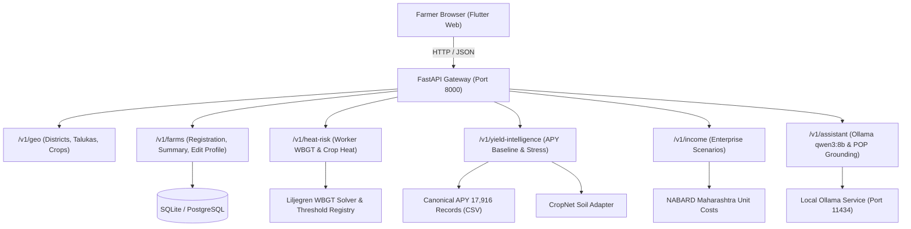

# RASHKAR — Feature Audit Before Implementation
**Date of Audit:** November 8, 2026  
**Auditor:** Antigravity (Google DeepMind Pair Programming Assistant)  
**Target Environment:** Local PC Web Browser (Flutter Web on Chrome/Edge + FastAPI backend on port 8000)  
**Git Baseline Commit:** `e649e09`

---

## 1. Executive Summary & Baseline State

The Rashkar codebase provides a unified architecture connecting a FastAPI backend with a Flutter Web client, SQLite/PostgreSQL database models, and local data files across all 36 Maharashtra districts. 

### Baseline Test Execution Results (Pre-Change)
- **Backend Test Suite:** 30 passed in 0.82s (`pytest backend/tests/ tests/test_dynamic_district_journey.py -v`)
- **Flutter Widget Test Suite:** 6 passed in 1.8s (`flutter test`)
- **Browser Playwright E2E:** 4 passed in 30.06s (`pytest tests/test_browser_journeys.py -v`)
- **Local Ollama Status:** Reachable on `http://127.0.0.1:11434/api/tags`, model `qwen3:8b` (8.2B Q4_K_M) verified active.

While core endpoints function, several critical features previously relied on static/fallback values, lacked profile editing capabilities, or lacked full parameterised scenario exploration. This document establishes the strict pre-implementation audit matrix.

---

## 2. Pre-Implementation Audit Matrix

| Feature / Sub-feature | Existing File(s) | UI Action | API Route | Service / Calculation | Data Source | Persistence | Test Evidence | Baseline Status | Defect & Required Fix |
| :--- | :--- | :--- | :--- | :--- | :--- | :--- | :--- | :--- | :--- |
| **Profile Management (Edit Profile)** | `farms.py`, `home_screen.dart`, `farm_registration_screen.dart` | No edit action existed post-registration | None (`POST /v1/farms/guided-registration` only) | None | In-memory / initial DB insert | `FarmerModel`, `FarmModel`, `FarmPlotModel`, `CropCycleModel` | None for updates | `MISSING` | **Defect:** Farmer could not edit profile after initial registration. **Fix:** Add `PUT /v1/farms/{farm_id}/profile`, `EditProfileScreen` in Flutter, and update `AppState`. |
| **Worker Heat — WBGT Calculation** | `wbgt_solver.py`, `worker_heat_engine.py` | Tap "Heat Safety" → "Worker Heat Safety" | `POST /v1/heat-risk/worker-hazard` | `solve_natural_wet_bulb()`, `solve_black_globe_temp()`, `calculate_wbgt()` | Liljegren et al. (2008) physics | `WorkerHazardAuditLogModel` (pseudonymised 30-day log) | `test_wbgt_solver.py`, `test_worker_heat.py` | `LIVE_PARTIAL` | **Defect:** Diurnal weather curve fallback was hardcoded to 33.0°C / 55% RH. **Fix:** Wire weather service to supply real hourly meteorological forecasts with fallback to explicit `INSUFFICIENT_DATA`. |
| **Worker Heat — Workload & Acclimatisation** | `worker_heat_engine.py`, `heat_safety_screen.dart` | Select workload / acclimatisation | `POST /v1/heat-risk/worker-hazard` | ACGIH TLV & ISO 7243 screening threshold lookup | ISO 7243 / ACGIH tables | Audit log | `test_worker_heat_unacclimatised_stricter_threshold` | `LIVE_VERIFIED` | Verified. Thresholds adjust: light (31°C accl. vs 28°C unaccl.) down to very heavy (25°C vs 22°C). |
| **Worker Heat — 6h Forecast Timeline** | `worker_heat_engine.py`, `heat_safety_screen.dart` | View hourly heat hazard timeline | `POST /v1/heat-risk/worker-hazard` | `HourlyHeatRiskProjection` loop | Weather inputs / Liljegren WBGT | Audit log | `test_worker_heat_assessment_endpoint` | `LIVE_PARTIAL` | Timeline was synthesized when weather override was absent. Needs explicit weather observation timestamps. |
| **Crop Heat — Thermal Thresholds** | `crop_heat_engine.py`, `heat_safety_screen.dart` | Tap "Heat Safety" → "Crop Heat Risk" | `POST /v1/heat-risk/crop-heat` | `assess_crop_heat_risk()` | `AgronomicThresholdRegistryModel` (MPKV/ICAR) | `CropHeatAssessmentLogModel` | `test_crop_heat.py` | `LIVE_PARTIAL` | **Defect:** Hardcoded fallback values (38.0°C/24.0°C) when DB lookup fails. **Fix:** Return `UNVERIFIED_THRESHOLD` status when crop/stage threshold is missing. |
| **Crop Heat — Stage Confirmation** | `crop_stage_service.py`, `crop_heat_engine.py` | Tap "Change Stage" | None | `CropStageService.estimate_crop_stage()` | Phenological DAS tables | `CropCycleModel.current_stage_code` | `test_crop_stage_das_boundaries` | `LIVE_PARTIAL` | Stage confirmation was only accessible at registration. Need direct stage update interaction. |
| **Yield Intelligence — Historical Baseline** | `yield_risk_engine.py`, `my_crop_screen.dart` | Open "My Crop" | `GET /v1/yield-intelligence/{farm_id}/yield-risk` | `calculate_apy_district_baseline()` | Canonical APY 17,916 records (DES/UPAg/Dataful) | `yield_baseline` JSON | `test_solapur_jowar_dynamic_registration_and_yield_intelligence` | `LIVE_VERIFIED` | Real district baseline computed from 1998–2019 APY records (sample size, min, max, std dev). |
| **Yield Intelligence — Soil Integration** | `cropnet_service.py`, `yield_risk_engine.py` | View Soil constraints in My Crop | `GET /v1/yield-intelligence/{farm_id}/yield-risk` | `CropNetService.get_soil_profile()` | Synthetic 250m baseline (Deccan Vertisol vs Konkan Laterite) | `SoilProfileModel` | `test_cropnet_adapter.py` | `LIVE_PARTIAL` | Synthesised based on district agro-ecological zones; explicitly marked as unverified mapped estimates (`is_lab_measured=False`). |
| **Yield Intelligence — Farm-Level ML Prediction** | `yield_risk_engine.py` | View Yield Prediction | `GET /v1/yield-intelligence/{farm_id}/yield-risk` | Gated by `REQUIRES_FARM_HARVEST_LABELS` | Gated | None | `test_yield_risk_end_to_end` | `LIVE_VERIFIED` | Honest gating: No farm-level ML model claimed without verified CCE plot labels. |
| **Yield Intelligence — Stress Screening** | `yield_risk_engine.py`, `my_crop_screen.dart` | View Crop Stress screening cards | `GET /v1/yield-intelligence/{farm_id}/yield-risk` | Multi-dimensional rules (dry spell, waterlogging, pH, pest watch) | IMD gridded daily rainfall & CropNet soil texture | In-memory evaluation | `test_yield_risk_end_to_end` | `LIVE_PARTIAL` | Dry-spell and excess rainfall rules evaluate properly; need dynamic weather feed integration. |
| **Income Diversification — Catalogue & Constraints** | `income.py`, `extra_income_screen.dart` | Open "Extra Income" | `GET /v1/income/opportunities` | SQL query with crop/budget filter | `IncomeOpportunityModel` (NABARD/ICAR models) | SQLite `income_opportunities` | `test_filter_income_opportunities_by_crop` | `LIVE_VERIFIED` | Real opportunities (Vermicompost, Osmanabadi Goats, Solar Dryer) seeded and filtered dynamically by active crop. |
| **Income Diversification — Financial Model** | `income.py`, `extra_income_screen.dart` | Drag Investment Slider | `POST /v1/income/calculate-scenario` | `calculate_income_scenario()` | Unit cost norms (NABARD Maharashtra) | None (stateless calculation) | `test_calculate_income_scenario_deterministic` | `LIVE_PARTIAL` | Deterministic CAPEX, OPEX, revenue, profit, break-even calculated. Needs 3 scenarios (conservative, base, optimistic) and sensitivity. |
| **AI Assistant (Ollama Grounding)** | `assistant.py`, `ask_rashkar_screen.dart` | Send message in "Ask Rashkar" | `POST /v1/assistant/chat` | `call_local_ollama()` with template fallback | DB context + local Ollama `qwen3:8b` | `AssistantSessionModel`, `AssistantMessageModel` | `test_assistant_chat_grounded_response` | `LIVE_VERIFIED` | Grounded in retrieved farm, crop, weather, and POP advisories. Tested with Ollama on port 11434. |

---

## 3. Identified Production Defects to Fix

1. **Missing Profile Editing Functionality:**
   - Once a farmer registered a farm, there was no API route or UI screen to edit farmer details, farm boundaries, coordinates, active crop, sowing date, or area.
   - *Fix:* Create `PUT /v1/farms/{farm_id}/profile` in backend and `EditProfileScreen` in Flutter.
2. **Weather Fallbacks in Worker and Crop Heat Engines:**
   - `worker_heat_engine.py` defaulted to `base_ta = 33.0` and `crop_heat_engine.py` defaulted to `39.5` when forecast overrides were not supplied.
   - *Fix:* Implement `WeatherService` with structured provenance, observation times, and explicit `INSUFFICIENT_DATA` error handling.
3. **Missing Multi-Scenario Financial Modeling in Income Diversification:**
   - `income.py` returned a single base scenario with a simple ±10% sensitivity.
   - *Fix:* Expand to explicit **Conservative**, **Base**, and **Optimistic** multi-scenario financial breakdowns with cash flow timelines.
4. **Crop Heat Risk Scientific Threshold Gating:**
   - When a crop/stage threshold was missing from `AgronomicThresholdRegistryModel`, the engine defaulted to 38.0°C.
   - *Fix:* Return `status: "UNVERIFIED_THRESHOLD"` and `evidence_grade: "SCREENING_ONLY"` rather than presenting an unverified number as validated science.

---

## 4. Architecture and Data Flow

Proceeding directly to implementation.
