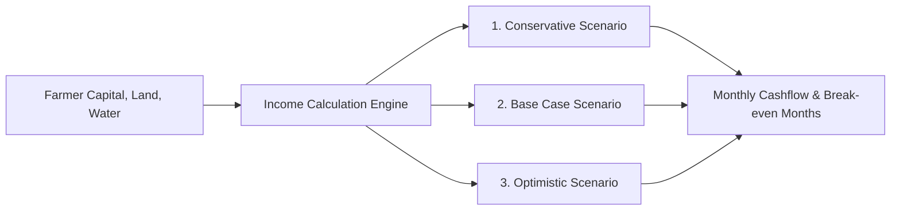

# RASHKAR — Income Diversification Methodology
**Resource-Bounded Financial Feasibility & Scenario Analysis**  
**Document ID:** RASHKAR-DOC-INCOME-01  
**Target Pilot:** Small & Marginal Farmers of Maharashtra  
**Version:** 2.0 (Dynamic Integration)

---

## 1. Objective and Approach

Single-crop reliance under climate volatility leaves smallholders highly vulnerable to total income collapse during extreme weather events. Income diversification offers a proven climate adaptation strategy. However, generic recommendations (e.g. "start a dairy farm" or "install a polyhouse") frequently fail because they disregard:
- Liquid working capital limits
- Available unallocated land or bund area
- Water reliability during summer months
- Seasonal feed costs and market absorption capacity

Rashkar implements an **opportunity matching and 3-scenario financial simulation engine** grounded in official NABARD unit costs and Agmarknet wholesale prices.

---

## 2. Institutional Data Foundations

### 2.1 NABARD Maharashtra FY26-27 Unit Costs
Capital expenditure (Capex) and recurring operational expenditure (Opex) are directly derived from the official NABARD State Focus Paper for Maharashtra:
- **Broiler Poultry (1,000 birds, all-in-all-out batch):**
  - Shed construction & equipment: ₹3,20,000
  - Day-old chicks, feed, medicine, litter: ₹1,80,000 / cycle
- **Dairy Unit (2 Crossbred Cows / Graded Murrah Buffaloes):**
  - Animal purchase & transport: ₹1,60,000
  - Shed, manger, chaff cutter: ₹50,000
  - Green fodder, concentrate feed, vet care: ₹6,000 / month
- **Goat Rearing (10 Does + 1 Buck unit - Osmanabadi breed):**
  - Breeding stock: ₹75,000
  - Night shelter & fencing: ₹25,000
  - Feed supplement, mineral mixture, vaccination: ₹1,500 / month
- **Apiculture / Beekeeping (10 Bee colonies with Italian bees *Apis mellifera*):**
  - Wooden boxes, hives, extractors, protective gear: ₹45,000
  - Sugar syrup supplementary feeding, migration: ₹5,000 / season
- **Oyster Mushroom Cultivation (100 bags indoor unit):**
  - Bamboo/thatch cropping room: ₹25,000
  - Paddy straw, spawn, PP bags, sprayer: ₹6,000 / flush
- **Sericulture (Mulberry silk rearing, 1 acre irrigated):**
  - Rearing house & rearing appliances: ₹1,75,000
  - DFLs (Disease-Free Layings), disinfectants: ₹18,000 / batch

### 2.2 Agmarknet / OGD Daily Wholesale Price Benchmarks
Revenues are computed using actual modal wholesale prices reported on Agmarknet across Maharashtra APMC mandis:
- Raw Cow Milk: ₹34.00 – ₹42.00 / Liter
- Broiler Live Weight: ₹85.00 – ₹115.00 / kg
- Live Goat Weight: ₹280.00 – ₹360.00 / kg
- Raw Multiflora Honey: ₹250.00 – ₹350.00 / kg
- Fresh Oyster Mushroom: ₹120.00 – ₹180.00 / kg
- Mulberry Silk Cocoons (Bivoltine): ₹450.00 – ₹650.00 / kg

---

## 3. Farmer Resource Filtering Architecture

Opportunities are evaluated against four hard feasibility constraints:
1. **Capital Feasibility:**
   $$\text{Initial Investment} \le \text{Available Working Capital} + \text{Eligible NABARD/KCC Subsidy Margin}$$
2. **Land Feasibility:**
   $$\text{Required Land} \le \text{Available Uncultivated Acreage / Bund Area}$$
3. **Water Requirement:**
   Opportunities requiring continuous high water (e.g. fodder cultivation for 5+ dairy animals) are filtered out if the farm is purely rainfed.
4. **Labor Availability:**
   Daily family labor hours must meet the enterprise requirement.

---

## 4. Three-Scenario Financial Simulation Engine

To protect farmers against over-optimistic projections, Rashkar calculates three distinct financial outcomes:

### 4.1 Scenario Specifications
- **Conservative Scenario (Stress Test):**
  - Output commodity price: $20\%$ below median modal APMC price.
  - Production yield / output: $15\%$ mortality or yield loss.
  - Operating cost (feed, energy): $+10\%$ inflation.
  - Represents drought or local market glut.
- **Base Case Scenario:**
  - Standard NABARD production benchmarks.
  - Median 12-month modal APMC mandi price.
  - Average mortality and standard input costs.
- **Optimistic Scenario:**
  - High commodity price ($+15\%$ above median).
  - Superior animal health and management ($+10\%$ yield).
  - Direct farm-gate or collective FPO marketing.

### 4.2 Key Financial Output Metrics
For each scenario, the engine computes:
- **Net Annual Profit (INR):** Total annual revenue minus operating expenses.
- **Monthly Net Cash Flow (INR):** Cash inflow schedule showing negative months before production begins.
- **Break-Even Period (Months):**
  $$\text{Break-Even Months} = \frac{\text{Initial Capital Outlay}}{\text{Monthly Average Net Profit}}$$
- **Capital Payback Feasibility:** Rated `FEASIBLE`, `MARGINAL`, or `HIGH_CAPITAL_RISK`.

---

## 5. Local Ollama AI Grounding & Deterministic Fallback

### 5.1 Hybrid Grounding Architecture
Rashkar supports local edge AI running Ollama (`qwen3:8b`):
1. **Financial Numbers are Never Generated by LLM:** All Capex, Opex, revenue, cash flow, and break-even numbers are calculated deterministically by Python functions.
2. **LLM Prompt Grounding:** The computed JSON numbers are injected into a strict system prompt instructing Ollama to summarize the feasibility and provide operational guidance in farmer-friendly language.
3. **Deterministic Fallback:** If Ollama daemon is offline or port 11434 is unreachable, Rashkar seamlessly serves structured deterministic text templates without disruption.
