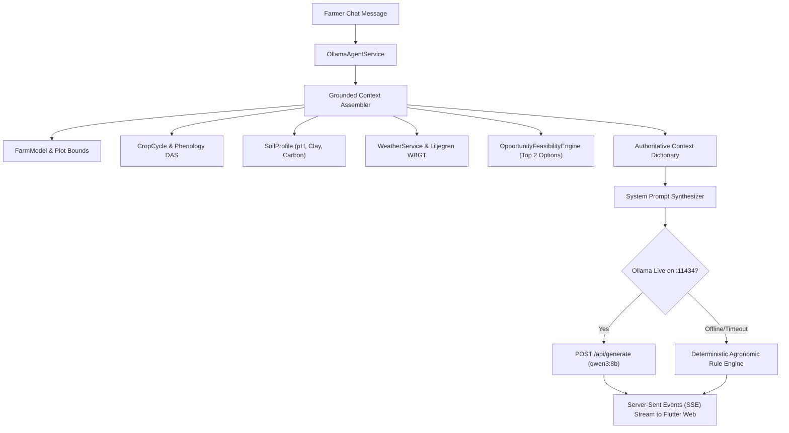

# Local Ollama AI Assistant Architecture (`qwen3:8b`)

## 1. Overview & Architectural Goals

The **Ask Rashkar** assistant is powered by a local Ollama instance running `qwen3:8b` (5.2 GB GGUF model) on `http://127.0.0.1:11434`.

Rather than acting as an ungrounded general conversational chatbot, the assistant operates as a **strictly grounded agronomic copilot** that incorporates the farmer's real-time farm parcel data, phenology, soil status, weather telemetry, and income feasibility into its reasoning before generating any token.

---

## 2. End-to-End Context Injection Pipeline

---

## 3. Strict Scientific Grounding & Safety Guardrails

The system prompt enforces strict operational guidelines:
1. **Never Hallucinate Claim Approvals**:
   - The assistant cannot promise or simulate PMFBY claim approval. It directs farmers to file evidence through the `/crop-loss` workflow with mandatory photo geotags.
2. **Never Fabricate Chemical Dosages**:
   - Pesticides and fungicides must refer to official MPKV/ICAR packages of practices.
3. **Proactive Heat Safety Intervention**:
   - If outdoor WBGT exceeds 28°C or air temperature exceeds 38°C, the assistant explicitly warns the farmer to avoid midday fieldwork between 11:30 AM and 3:30 PM and take regular hydration pauses.
4. **Zero-Latency Fallback**:
   - If Ollama is offline or experiences memory load delay, the assistant automatically switches to the deterministic grounded rule engine, returning structured agronomic guidance with zero crash.

---

## 4. API Endpoints

- **`GET /v1/assistant/context?farm_id={farm_id}`**:
  Returns the grounded profile chip label (e.g., *"Using your farm information: Onion (Bulb Development) · Niphad · 3.0 acres"*).
- **`POST /v1/assistant/chat`**:
  Standard JSON request/response with citation list and session history persistence.
- **`POST /v1/assistant/chat-stream`**:
  Server-Sent Events (SSE) endpoint providing streaming token delivery for real-time typing animation in Flutter Web.
