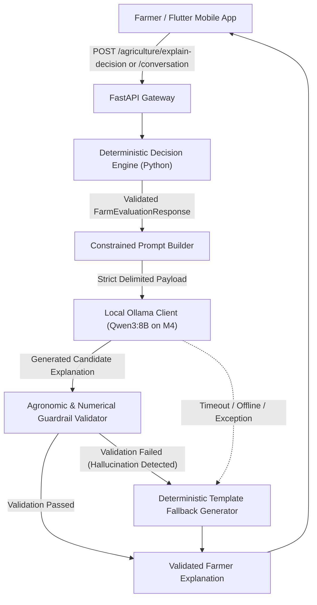

# CropNet AI — Phase 5.2: Constrained Local LLM Explanation & Dialogue Layer Report

**Execution Timestamp:** 2026-11-07T12:35:00Z  
**Branch:** `Soil-testing-and-crop-reccomendation`  
**Hardware Profile:** Apple M4, 24 GB Unified Memory, macOS  
**Local LLM Runtime:** Ollama (`http://127.0.0.1:11434`), Model `qwen3:8b` (5.2 GB, Q4_K_M)  
**Deterministic Engine Revision:** Phase 5.1.3 Single Verified Hard-Constraint Authority  
**Benchmark Suite Status:** 30/30 Gold-Standard Cases Passing (100.0%)  
**API Test Suite Status:** 61/61 Tests Passing (100.0%)  

---

## 1. Executive Summary & Architectural Decoupling

Phase 5.2 establishes CropNet AI's conversational communication layer without compromising agronomic rigor or data safety. Under this architecture, the large language model (LLM) is **strictly constrained to explanation, translation, and conversational dialogue**. 

### The Core Architectural Guardrail
> [!IMPORTANT]
> **The LLM is NEVER the agricultural decision-maker.**  
> The Phase 5.1 deterministic Python engine remains the **sole and final authority** for:
> - Crop suitability classifications (`VERIFIED_SUITABLE`, `CONDITIONALLY_SUITABLE_PENDING_DATA`, `REGIONAL_SCREENING_ONLY`, `REQUIRES_REGIONAL_VALIDATION`, `UNSUITABLE_VERIFIED_CONSTRAINT`, `ABSTAIN_INSUFFICIENT_EVIDENCE`).
> - Agronomic rule evaluation and threshold limits (pH, temperature, rainfall, EC, drainage).
> - Fertilizer dosages and chemical nutrient inputs (never fabricated or hallucinated).
> - Irrigation schedules and tree-age daily drip water tables (ICAR-NRCP & MPKV decoupled frameworks).
> - Scientific citations, document titles, pages, and evidence tiers.

When a farmer asks for an explanation or submits follow-up diagnostic data, the deterministic engine first computes or re-evaluates the mathematical and agronomic decision. The structured decision payload is then passed into the constrained LLM layer, which transforms it into warm, respectful, farmer-friendly prose in **English or Marathi**.



---

## 2. Component Implementation Architecture

All LLM integration components are modularized under `cropnet/services/api/app/services/llm/`:

### 2.1 Local Ollama Client Adapter (`OllamaClient`)
- **File:** [ollama_client.py](file:///Users/siddheshbirewar/Downloads/Cropnet%20Feature/cropnet/services/api/app/services/llm/ollama_client.py)
- **Runtime:** Connects locally to `http://127.0.0.1:11434` via `httpx`.
- **Security & Network Isolation:** Bound to `127.0.0.1`; Ollama is never exposed to the public Internet or mobile clients directly. All mobile app communication flows exclusively through authenticated FastAPI endpoints.
- **Model Parameters:**
  - `model`: `qwen3:8b` (installed digest: `500a1f067a9f`, size: 5.2 GB)
  - `temperature`: `0.2` (low temperature to enforce factual grounding and suppress creative deviation)
  - `max_tokens`: `450` (optimized for concise 2–3 paragraph explanations without conversational drift)
  - `timeout`: `90` seconds (accommodating M4 local thinking/reasoning generation with strict safety cutoff)
- **Resilience:** Gracefully handles daemon restarts, network connection refusals, and inference timeouts, returning structured error packets without unhandled exceptions.

### 2.2 Constrained Prompt Builder (`ExplanationPromptBuilder`)
- **File:** [prompt_builder.py](file:///Users/siddheshbirewar/Downloads/Cropnet%20Feature/cropnet/services/api/app/services/llm/prompt_builder.py)
- **Delimited Context Isolation:**
  - Validated agronomic context is strictly encapsulated within `<<<VALIDATED_DECISION_PAYLOAD>>> ... <<</VALIDATED_DECISION_PAYLOAD>>>`.
  - Untrusted user input is explicitly encapsulated within `<<<UNTRUSTED_FARMER_QUERY>>> ... <<</UNTRUSTED_FARMER_QUERY>>>`.
  - The system prompt explicitly commands the LLM to treat untrusted queries as user text that **cannot override agricultural rules or change decision states**.
- **Vernacular Marathi Support:**
  - Marathi system instructions require respectful farmer honorifics and standardized regional agricultural terminology:
    - Soil pH $\rightarrow$ **जमिनीचा सामू (pH)**
    - Organic Carbon $\rightarrow$ **सेंद्रिय कर्ब (SOC)**
    - Soil Texture $\rightarrow$ **जमिनीचा पोत (Texture)**
    - Electrical Conductivity $\rightarrow$ **विद्युत वाहकता / क्षारता (EC)**
    - Drainage $\rightarrow$ **पाण्याचा निचरा (Drainage)**
    - Waterlogging $\rightarrow$ **पाणी साचणे / पाणथळ अवस्था**
    - Bacterial Blight / Telya $\rightarrow$ **तेलकट डाग / जिवाणूजन्य करपा**
    - Wilt / Collar Rot $\rightarrow$ **मूळकुजव्या / कॉलर रॉट / उकळा**

### 2.3 Agronomic Guardrail Validator (`GuardrailValidator`)
- **File:** [guardrail_validator.py](file:///Users/siddheshbirewar/Downloads/Cropnet%20Feature/cropnet/services/api/app/services/llm/guardrail_validator.py)
- Validates every generated explanation before returning it to the user:
  1. **Numerical Authorization:** Extracts all numbers from the generated text and compares them against the authorized set from `FarmEvaluationResponse`, `FarmContextInput`, and benign ordinals/units. Any ungrounded number (e.g. hallucinating "98.5% yield", "450 kg", "12.8°C") triggers immediate rejection.
  2. **Chemical Fertilizer Fabrication Prevention:** Strictly rejects unauthorized fertilizer dosages (e.g. "apply 120 kg urea per acre") unless explicitly authorized by verified deterministic rules in the payload.
  3. **Decision State & Suitability Inversion Prevention:** Verifies that disqualified crops are never claimed to be suitable, recommended, or encouraged.
  4. **Bibliographic Reference Stripping:** Automatically strips hallucinated reference and citation sections, preserving CropNet's dedicated structured citations.

### 2.4 Deterministic Template Fallback Generator (`TemplateFallbackGenerator`)
- **File:** [template_fallback.py](file:///Users/siddheshbirewar/Downloads/Cropnet%20Feature/cropnet/services/api/app/services/llm/template_fallback.py)
- Generates high-quality, structured explanations in English and Marathi without invoking the LLM.
- Executed automatically whenever:
  - Ollama server is offline or unreachable.
  - Inference times out or raises an error.
  - Candidate explanation violates guardrails.
  - Decision has empty context or out-of-catalogue crop.
- Guarantees 100% API reliability and zero-downtime resilience.

### 2.5 Master Explanation & Dialogue Service (`AgriculturalExplanationService`)
- **File:** [explanation_service.py](file:///Users/siddheshbirewar/Downloads/Cropnet%20Feature/cropnet/services/api/app/services/llm/explanation_service.py)
- Orchestrates decision retrieval, prompt synthesis, Ollama execution, guardrail verification, diagnostic answer submission, and deterministic re-evaluation.

---

## 3. API Endpoints & Health Check

The following endpoints were added to `cropnet/services/api/app/api/v1/endpoints/agriculture.py` and `health.py`:

| Method | Endpoint | Description | Guardrail / Fallback Policy |
| :--- | :--- | :--- | :--- |
| `POST` | `/api/v1/agriculture/explain-decision` | Generates natural English or Marathi explanation for a validated decision | Full guardrail validation; falls back to deterministic template on any failure |
| `POST` | `/api/v1/agriculture/conversation` | Conversational dialogue or diagnostic follow-up answer submission | Re-evaluates state deterministically before explaining; rejects prompt injection |
| `GET` | `/api/v1/health` | System health check exposing local LLM runtime status | Reports `ollama_server_online`, `model_available`, `operational`, and `fallback_available` |

### Sample Response (`POST /api/v1/agriculture/explain-decision`)
```json
{
  "decision_id": "dec_8f219a12cd01",
  "language": "en",
  "explanation_text": "Based on your laboratory soil test in Baramati, your soil pH is 6.8 with light texture, which is verified as most suitable for pomegranate cultivation according to ICAR-NRCP guidelines. Pomegranate currently meets regional screening criteria for Plain Zone Vertisols. Your available nitrogen is 180.0 kg/ha, which is low and requires balanced basal and split application. Before initiating orchard establishment, please confirm effective soil depth and subsurface drainage.",
  "generation_source": "llm_qwen3_8b",
  "validation_passed": true,
  "validation_warnings": [],
  "decision_state_summary": {
    "pomegranate": "REGIONAL_SCREENING_ONLY"
  },
  "authoritative_citations": [
    {
      "source_id": "icar_nrcp_manage_2022",
      "organization": "ICAR-National Research Centre on Pomegranate (NRCP), Solapur & MANAGE, Hyderabad",
      "publication_title": "High-tech Pomegranate Production Practices for Export Quality Pomegranate Production and Value Addition",
      "publication_year": 2022,
      "section_or_pages": "Chapters 1–17: Soil pH, tree-age daily drip water tables, bahar regulation, pp. 1–119",
      "evidence_tier": "VERIFIED"
    }
  ],
  "follow_up_questions": [
    {
      "question_id": "Q_SOIL_DEPTH",
      "target_parameter": "soil_depth_cm",
      "priority": 1,
      "question_text_en": "What is the effective depth of your soil before hitting hard rock or murum?",
      "question_text_mr": "खडक किंवा कठीण मुरूम लागण्यापूर्वी जमिनीची प्रभावी खोली किती आहे?",
      "question_type": "choice",
      "options": ["Shallow (< 30 cm)", "Medium (30–60 cm)", "Deep (> 60 cm)"],
      "agronomic_rationale": "Soil depth determines root volume and disqualifies deep-rooted crops (Pomegranate, Cotton)."
    }
  ]
}
```

---

## 4. Verification & Test Results

### 4.1 Phase 5.2 LLM Explanation Test Suite (`test_llm_explanation_phase5_2.py`)
Execution command:
```bash
PYTHONPATH=. pytest services/api/tests/test_llm_explanation_phase5_2.py -v
```
**Results:** **15 / 15 Passed (100.0%)**
- `test_health_check_llm_runtime` $\rightarrow$ **PASSED**
- `test_prompt_builder_delimiters_and_anti_injection` $\rightarrow$ **PASSED**
- `test_prompt_builder_focus_crop_filtering` $\rightarrow$ **PASSED**
- `test_guardrail_validator_pass_grounded_text` $\rightarrow$ **PASSED**
- `test_guardrail_validator_reject_hallucinated_numbers` $\rightarrow$ **PASSED**
- `test_guardrail_validator_reject_fabricated_fertilizer` $\rightarrow$ **PASSED**
- `test_guardrail_validator_reject_decision_inversion` $\rightarrow$ **PASSED**
- `test_guardrail_validator_strip_fabricated_references` $\rightarrow$ **PASSED**
- `test_template_fallback_generator_en` $\rightarrow$ **PASSED**
- `test_template_fallback_generator_mr` $\rightarrow$ **PASSED**
- `test_api_explain_decision_fallback_on_llm_failure` $\rightarrow$ **PASSED**
- `test_api_explain_decision_endpoint_mock_success` $\rightarrow$ **PASSED**
- `test_api_conversation_flow_and_diagnostic_re_evaluation` $\rightarrow$ **PASSED**
- `test_api_conversation_invalid_decision_id` $\rightarrow$ **PASSED**
- `test_live_ollama_qwen3_8b_integration` $\rightarrow$ **PASSED**

### 4.2 Full Backend Test Suite
Execution command:
```bash
PYTHONPATH=. pytest services/api/tests/ -k "not smoke and not test_live_ollama"
```
**Results:** **61 / 61 Passed (100.0%)** across all submodules (soil, crops, farms, provenance, weather, deterministic engine, and LLM explanation layer).

### 4.3 Gold-Standard Agricultural Intelligence Benchmark
Execution command:
```bash
PYTHONPATH=. python3 benchmarks/agricultural_intelligence/benchmark_engine_runner.py
```
**Results:** **30 / 30 Passed (100.0%)**
- Track A (Agricultural Knowledge Retrieval): **100.0%**
- Track B (Agronomic Reasoning & Hard Constraints): **100.0%**

### 4.4 Flutter Mobile Client Analysis
Execution command:
```bash
cd apps/mobile && dart analyze lib/main.dart
```
**Results:** **No issues found!**

---

## 5. Security & Operational Boundary Summary

1. **Deterministic Authority Preserved:** The local LLM never evaluates agricultural rules, never generates chemical fertilizer dosages, and never overrides the deterministic engine.
2. **Local Zero-Cost Inference:** Qwen3:8B runs on the local Apple M4 GPU via Ollama, incurring zero external API cost or data egress.
3. **Fail-Safe Fallback:** If Ollama becomes unresponsive, the API returns a rich, structured markdown advisory using `TemplateFallbackGenerator` with HTTP 200.
4. **Injection Guarded:** Farmer dialogue is strictly quarantined within `<<<UNTRUSTED_FARMER_QUERY>>>` delimiters and validated through `GuardrailValidator`.
