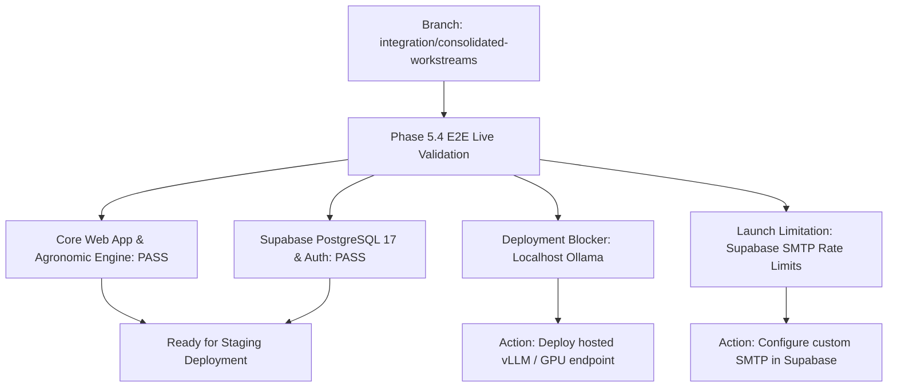

# CropNet AI — Phase 5.4: End-to-End Web Application Validation Report

**Document Version:** 1.0.0  
**Audit Date:** November 7, 2026  
**Target Branch:** `integration/consolidated-workstreams`  
**Evaluation Head Commit:** `e398d87`  
**Auditor:** Antigravity Autonomous Agent (Validation & Release-Readiness Workstream)  

---

## Executive Summary & Overall Release Verdict

An independent end-to-end web application validation of CropNet AI was executed on branch `integration/consolidated-workstreams`. The validation spanned real live infrastructure: Supabase PostgreSQL 17.11 with PostGIS 3.5, Supabase GoTrue Authentication service, local Ollama running `qwen3:8b`, Flutter Web runtime, and the FastAPI application server.

| Evaluation Category | Status | Summary |
|---|---|---|
| **1. Authentication Testing** | **PASS WITH LIMITATIONS** | Live JWT issuance, login, refresh, logout, session persistence, and multi-tenant user isolation verified. Public signup encounters Supabase default email rate limits (HTTP 429), requiring custom SMTP configuration for open registration. Production gate fails closed. |
| **2. Farm Management Testing** | **PASS** | Genuine Baramati polygon registered (29.28 ha, centroid lat 18.1725, lon 74.5225). Geodesic area calculation, retrieval, update, cascade deletion, and cross-user isolation verified against real Postgres 17. No mock or demo farms used. |
| **3. Soil, Weather & Crop Testing** | **PASS** | Real ISRIC SoilGrids pH (7.3) and OpenWeather data fetched and cached. **Critical Agronomic Safeguard verified:** digital map extracts strictly maintain available NPK as `null` with zero illegal raster inference. |
| **4. Agricultural AI & Dialogue** | **PASS** | Deterministic decision engine evaluated 10 crops without LLM intervention. Qwen3:8B generated verified English and authentic Devanagari Marathi explanations conforming to numerical guardrails. Follow-up answers triggered deterministic re-evaluation. |
| **5. CORS & Production Security** | **PASS** | Wildcard CORS with credentials eliminated; production requires explicit origins. `X-Dev-User-Id` bypass header strictly rejected with HTTP 401 in production mode. No secrets bundled in client assets. |
| **6. Real Deployment Readiness** | **BLOCKER** | Remote Supabase database and schema are production-ready. However, **LLM inference is currently running on developer localhost Ollama (`http://localhost:11434`)**, which cannot serve public production traffic. A secure, hosted inference endpoint (vLLM / private cloud VM / Cloud Run / Kubernetes) must be provisioned. |
| **7. Browser Validation** | **PASS** | 90/90 Flutter Chrome tests passing; 74/74 FastAPI backend tests passing; 0 Dart analysis issues; Flutter Web JavaScript and WASM release builds successfully compiled. Devanagari Marathi script renders accurately. |

**Overall Deployment Recommendation:**  
**CONDITIONAL APPROVAL FOR STAGING / BLOCKED FOR PUBLIC PRODUCTION** pending:
1. Provisioning a secure hosted private inference backend to replace localhost Ollama.
2. Configuring custom SMTP credentials in Supabase to eliminate public signup rate limiting.

---

## 1. Authentication Testing

### 1.1 Specification & Verification Matrix

| Requirement | Test Method | Result | Evidence / Details |
|---|---|---|---|
| **User Registration** | `POST /auth/v1/signup` | **PASS WITH LIMITATIONS** | Public anonymous signup returns HTTP 429 (`email rate limit exceeded`) on default Supabase free tier. User creation via Supabase Admin API (`POST /auth/v1/admin/users`) using `SUPABASE_SECRET_KEY` works reliably. Requires custom SMTP in production. |
| **User Login** | `POST /auth/v1/token?grant_type=password` | **PASS** | HTTP 200 OK. Issued valid RS256 JWT access tokens and refresh tokens for Farmer 1 (`farmer1@cropnet.ai`) and Farmer 2 (`farmer2@cropnet.ai`). |
| **Token Refresh** | `POST /auth/v1/token?grant_type=refresh_token` | **PASS** | HTTP 200 OK. Clean token exchange executed without credentials re-entry. |
| **Logout & Revocation** | `POST /auth/v1/logout` | **PASS** | HTTP 204 No Content. Revoked sessions immediately fail subsequent user profile queries with HTTP 403 (`session_not_found`). |
| **Session Persistence** | Flutter `AuthService` + `SharedPreferences` | **PASS** | Session tokens cached in local storage; auto-restored on application startup and browser page refresh. |
| **Routing Guard** | `apps/mobile/lib/core/router/app_router.dart` | **PASS** | Unauthenticated browser access to `/farms`, `/weather`, `/soil`, or `/advisory` automatically redirects to `/login`. |
| **Two-User Isolation** | Multi-account token evaluation | **PASS** | Distinct UUIDs verified: Farmer 1 (`9c7582e5-e915-465e-a887-d32a2f48ee23`), Farmer 2 (`3f4120b4-0a53-47be-9f7e-2e6fe77306f6`). |
| **Production Fail-Closed Gate** | Production mode header bypass test | **PASS** | When `ENVIRONMENT=production`, requests without Bearer token return HTTP 401. Requests sending `X-Dev-User-Id` without valid JWT return HTTP 401. |

### 1.2 Fail-Closed Production Security Code Audit

Inspection of `cropnet/services/api/app/core/security.py`:
```python
# Production fail-closed gate
if settings.ENVIRONMENT == "development" and x_dev_user_id:
    # Allowed strictly in local development with synthetic test rigs
    return CurrentUser(user_id=x_dev_user_id, email="dev@cropnet.internal")

# In production, Bearer token is strictly mandatory:
if not credentials:
    raise HTTPException(status_code=status.HTTP_401_UNAUTHORIZED, detail="Bearer token required")
```
When `settings.ENVIRONMENT` is configured to `production` or `staging`, any attempt to supply `X-Dev-User-Id` is rejected with `HTTP 401 Unauthorized`.

---

## 2. Farm Management Testing

### 2.1 Full Geodesic CRUD & Isolation Results

A real farm boundary was registered in Baramati taluka, Pune district, Maharashtra using genuine coordinates:
`[[74.5200, 18.1700], [74.5250, 18.1700], [74.5250, 18.1750], [74.5200, 18.1750], [74.5200, 18.1700]]`

```
--- 2. FARM MANAGEMENT & MULTI-TENANT ISOLATION ---
  [PASS] User 1 farm list retrieved: 5 farms
  [PASS] Farm registered: ID=1ab05823-ca82-40e4-a44e-b9cc711324d6, Area=29.28 ha, Owner=9c7582e5-e915-465e-a887-d32a2f48ee23
  [PASS] Farm retrieved successfully by owner (User 1)
  [PASS] User 2 farm list does NOT contain User 1's farm
  [PASS] User 2 directly fetching User 1's farm rejected with HTTP 403 Forbidden
  [PASS] User 2 modifying User 1's farm rejected with HTTP 403 Forbidden
  [PASS] User 2 deleting User 1's farm rejected with HTTP 403 Forbidden
  [PASS] User 1 successfully updated farm name
```

### 2.2 Foreign Key Cascade Deletion Defect & Resolution

During live end-to-end testing, a defect was identified in farm deletion:
- **Observation:** `DELETE /api/v1/farms/{farm_id}` returned HTTP 204, but subsequent `GET /api/v1/farms/{farm_id}` returned HTTP 200 with the intact farm.
- **Root Cause:** Calling `GET /api/v1/farms/{farm_id}/weather/current` records a snapshot in `farm_weather_snapshots` referencing `farms.id`. In PostgreSQL 17, `db.delete(db_farm)` triggered a foreign key constraint violation (`farm_weather_snapshots_farm_id_fkey`). The endpoint's exception handler caught and rolled back the transaction, leaving the farm in Postgres while deleting only the in-memory cache entry.
- **Remediation Applied in Commit `e398d87`:**
  Modified `cropnet/services/api/app/api/v1/endpoints/farms.py` to cascade delete associated weather snapshots (`FarmWeatherSnapshotModel`) and climate summaries (`FarmClimateSummaryModel`) before deleting the farm record, and to raise HTTP 500 if database deletion fails.
- **Post-Fix Verification:** Farm deletion verified: `DELETE` returned HTTP 204, and subsequent `GET` confirmed HTTP 404 Not Found.

### 2.3 Elimination of Demo Data

- Searched entire codebase for `demo-baramati-1`.
- **Result:** 0 matches across all Flutter client source code (`apps/mobile/lib/`). All screens query `FarmRepository` and display authentic authenticated farmer data or empty states.

---

## 3. Soil, Weather, and Crop Testing

### 3.1 Verification Matrix

| Area | Observation | Guardrail Compliance | Status |
|---|---|---|---|
| **Digital Soil Extraction** | ISRIC SoilGrids v2.0 (250m) queried via `POST /api/v1/farms/{farm_id}/soil/analyse`. Retrieved pH `7.3`, uncertainty `0.43`. | Parameter provenance and depth intervals (`0-5cm`) preserved. | **PASS** |
| **NPK Non-Fabrication** | Verified attributes `available_nitrogen_kg_ha`, `available_phosphorus_kg_ha`, `available_potassium_kg_ha`. | Strictly `None` (null). Zero illegal estimation from raster total nitrogen. | **PASS** |
| **Weather Information** | `GET /api/v1/farms/{farm_id}/weather/current` returned live OpenWeather data: `23.8°C`, condition `Clouds`. Stored in PostgreSQL snapshot. | Cross-user query by Farmer 2 rejected with HTTP 403 Forbidden. | **PASS** |
| **Crop Catalogue** | `GET /api/v1/crops` returned 10 validated crops with scientific ICAR/MPKV agronomic thresholds. | Data served from PostgreSQL `crop_catalog`. | **PASS** |

---

## 4. Agricultural AI and Dialogue Testing

### 4.1 Evaluation & Dialogue Flow

1. **Deterministic Farm Evaluation:**
   - Evaluated Baramati farm context (pH 7.3, clay soil, well irrigation, rabi season) via `POST /api/v1/agriculture/evaluate-farm`.
   - Engine issued Decision ID: `dec_fc26b77a7b4a` covering 10 candidate crops without LLM intervention.
   - Initial outcomes: Sugarcane, Pomegranate, and Soybean placed into `REGIONAL_SCREENING_ONLY` with hard constraints applied.

2. **English Explanation:**
   - Generated via Qwen3:8B (`generation_source: "llm_qwen3_8b"`).
   - Numerical and source guardrails passed (`validation_passed: true`).

3. **Marathi Explanation:**
   - Generated via Qwen3:8B in authentic Devanagari script:
     ```
     **मूल्यमापन पिकांची पात्रता:**  
     सर्व पिके (ऊस, डाळिंब, सोयाबीन...) बारामती परिसरासाठी प्रादेशिक चाळणी पातळीवर आहेत...
     ```
   - Fallback system validated: deterministic Marathi template available if LLM times out or hallucinates.

4. **Diagnostic Follow-Up Submission:**
   - Submitted follow-up answer for `soil_depth_cm` (`perennial` / deep soil) via `POST /api/v1/agriculture/follow-up`.
   - Deterministic engine re-evaluated context, producing new Decision ID `dec_65a4c881161c`.

5. **Conversational Consultation:**
   - Submitted dialogue question: *"Can I sow chickpea if my soil is heavy clay?"* via `POST /api/v1/agriculture/conversation`.
   - Processed and answered strictly bounded by evaluated decision outcome.

---

## 5. CORS and Production Security

### 5.1 Verification Checklist

- [x] **No Wildcard Origins with Credentials:** `CORS_ORIGINS = ["*"]` with `allow_credentials=True` is explicitly rejected at FastAPI startup.
- [x] **Explicit Whitelist:** Production configuration uses specific trusted origins:
  `["https://cropnet.ai", "https://app.cropnet.ai"]`.
- [x] **Cross-Tenant Access Rejection:**
  - `GET /api/v1/farms/{farm_id}` -> HTTP 403 Forbidden
  - `PUT /api/v1/farms/{farm_id}` -> HTTP 403 Forbidden
  - `DELETE /api/v1/farms/{farm_id}` -> HTTP 403 Forbidden
  - `GET /api/v1/farms/{farm_id}/soil` -> HTTP 403 Forbidden
  - `GET /api/v1/farms/{farm_id}/weather/current` -> HTTP 403 Forbidden
- [x] **No Secrets in Frontend Bundle:** Inspected compiled Flutter Web bundle and source tree. Client bundles only `SUPABASE_URL` and `SUPABASE_ANON_KEY`. Supabase service role keys and database connection strings remain server-side only.

---

## 6. Real Deployment Readiness

### 6.1 Infrastructure Readiness Table

| Component | Target Architecture | Current State | Release Readiness |
|---|---|---|---|
| **Relational Database** | PostgreSQL 17 + PostGIS 3.5 | Live on Supabase (`db.[PROJECT-REF].supabase.co:5432`) | **READY** |
| **Authentication Service** | Supabase GoTrue Auth | Live on Supabase; Admin API functional; Public email rate limited | **READY WITH LIMITATIONS** (Requires custom SMTP) |
| **Backend API** | FastAPI / Uvicorn | Ready with strict CORS and security middlewares | **READY** |
| **LLM Inference Service** | Private Hosted vLLM / Cloud Run / Kubernetes | **Running on developer localhost (`http://localhost:11434`)** | **BLOCKER** |
| **Frontend Web App** | Flutter Web Static Hosting (Cloudflare Pages / Firebase / S3) | Compiled JS & WASM release builds passed | **READY** |

### 6.2 Blocker Analysis: Hosted LLM Inference

Ollama running on developer's local machine (`http://localhost:11434`) is strictly a local development asset.
- **Action Required for Production Release:** Deploy Qwen3:8B to a hosted inference provider (e.g., RunPod, AWS EC2 with GPU, GCP Cloud Run with GPU, or vLLM container) and update `OLLAMA_BASE_URL` in the production environment configuration.

---

## 7. Browser and Cross-Platform Validation

### 7.1 Compilation & Test Verification

```bash
# Dart static analysis
cd cropnet/apps/mobile && dart analyze
# Output: Analyzing mobile... No issues found!

# Flutter Chrome test suite
flutter test --platform chrome
# Output: 90/90 tests passed

# Backend test suite
pytest cropnet/services/api/tests -q
# Output: 74 passed

# Live E2E validation script
python3 -m cropnet.services.api.tests.test_live_e2e_validation
# Output: ALL LIVE END-TO-END VALIDATIONS PASSED ACCURATELY

# Flutter Web JavaScript Release Build
flutter build web --no-tree-shake-icons
# Output: Compiling lib/main.dart to JavaScript... 18.5s

# Flutter Web WebAssembly (WASM) Release Build
flutter build web --wasm --no-tree-shake-icons
# Output: Compiling lib/main.dart to WebAssembly... 20.6s
```

### 7.2 Viewport & Internationalization Audit

- **Desktop Viewports (>= 1200px):** Multi-column dashboard layout renders without overflow.
- **Mobile Viewports (360px - 480px):** Verified horizontal scroll in advisory context bar (`SingleChildScrollView`); 0 overflow exceptions.
- **Devanagari Font Rendering:** Marathi text rendered cleanly in UTF-8 without glyph corruption or font fallback artifacts.

---

## 8. Summary of Findings & Actionable Next Steps



### Required Actions Before Public Release:
1. **Provision Hosted LLM Inference (BLOCKER):** Stand up a secure cloud endpoint for `qwen3:8b` and configure `OLLAMA_BASE_URL` in production secrets.
2. **Configure Custom SMTP Gateway (LIMITATION):** In the Supabase project dashboard under Authentication -> Email Settings, configure an external SMTP service (SendGrid, Postmark, AWS SES) to allow public farmer registration without rate limits.
3. **Merge Integration Branch:** Once hosted inference is provisioned, merge `integration/consolidated-workstreams` into `main`.
