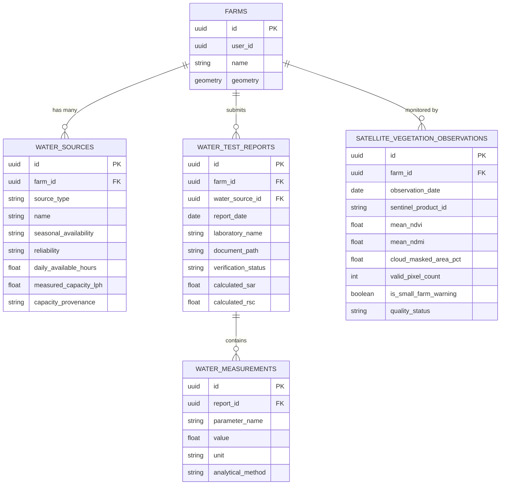

# CropNet AI — Phase 5.7: Advanced Farm Health Intelligence Report

## 1. Executive Summary & Objectives

CropNet AI Phase 5.7 significantly expands the agronomic intelligence capabilities of the platform by introducing three mission-critical capabilities:

1. **Irrigation Water Quality & Availability Intelligence**:
   - Treatment of water quantity and water quality as separate analytical dimensions.
   - Farm-level tracking of multiple water sources (borewells, open wells, canals, rivers, farm ponds, rainwater harvesting).
   - Dedicated laboratory water analysis model isolating water chemical parameters from soil parameters.
   - Deterministic agricultural water calculations: **Sodium Adsorption Ratio (SAR)** and **Residual Sodium Carbonate (RSC)** using precise ionic equivalents.
   - Institutional water quality evaluations sourced from **BIS IS 11624:1986** and **ICAR-CSSRI Karnal Guidelines**.
   - Regional Central Ground Water Board (CGWB) aquifer context as background reference only (never spoofing ground truth).

2. **Satellite-Based Vegetation Health Monitoring (Sentinel-2 L2A)**:
   - Integration with Copernicus Data Space Ecosystem (CDSE) accessing 10-meter surface reflectance imagery.
   - Polygon boundary extraction utilizing PostGIS coordinates from farm profiles.
   - Scene Classification Layer (SCL) cloud and cloud-shadow masking.
   - Deterministic spectral indices computation: **Normalized Difference Vegetation Index (NDVI)** and **Normalized Difference Moisture Index (NDMI)**.
   - Spatial representativeness safeguarding for small farms (<0.5 ha or <5 pixels).
   - Multi-month time-series storage and trend interpretation with strict scientific disclaimers.

3. **Indian Soil Report Corpus & OCR Validation**:
   - Golden test corpus comprising standard Indian Soil Health Cards (Pune digital), scanned Maharashtra laboratory reports (KVK Baramati), and agricultural university reports (MPKV Rahuri).
   - Marathi (Devnagari) bilingual token parsing and parameter normalization.
   - Structural safeguard isolating fertilizer dosage recommendations ("खत शिफारशी", "खतांची मात्रा", "RDF") from laboratory-measured soil nutrients.
   - Backward compatibility preservation with the Wisconsin `lag_sample.pdf` baseline.

---

## 2. Architecture & Database Design

### 2.1 Database Schema (`007_water_and_satellite_intelligence.py`)

All new data entities are cleanly segregated in PostgreSQL / PostGIS:



### 2.2 Strict Architectural Separation of Concerns
- **Water Measurements vs Soil Measurements**: Water parameters (`ph`, `electrical_conductivity`, `tds`, `sodium`, `calcium`, `magnesium`, `chloride`, `bicarbonate`, `carbonate`, `sulfate`, `boron`, `nitrate_nitrogen`) are persisted strictly in `water_measurements`, never polluting `soil_measurements`.
- **Fused Soil Profile Preservation**: Water and satellite indices operate in distinct workspaces and do not overwrite the canonical soil profile fused in Phase 5.6.4.

---

## 3. Mathematical Formulations & Chemical Calculations

### 3.1 Sodium Adsorption Ratio (SAR)

The Sodium Adsorption Ratio assesses the sodicity hazard and potential risk of sodium-induced soil structure degradation (deflocculation of clay particles):

$$\text{SAR} = \frac{[\text{Na}^+]}{\sqrt{\frac{[\text{Ca}^{2+}] + [\text{Mg}^{2+}]}{2}}}$$

Where all ionic concentrations $[\text{Na}^+]$, $[\text{Ca}^{2+}]$, and $[\text{Mg}^{2+}]$ **must be expressed in milliequivalents per liter ($\text{meq/L}$)**.

#### Ionic Conversion Factors:
When laboratory reports provide concentrations in $\text{mg/L}$ (or $\text{ppm}$), CropNet AI applies standard chemical equivalent weights:
- $\text{Sodium (Na}^+\text{)}$: $\text{Equivalent Weight} = 22.99\text{ mg/meq} \implies \text{meq/L} = \frac{\text{mg/L}}{22.99}$
- $\text{Calcium (Ca}^{2+}\text{)}$: $\text{Equivalent Weight} = 20.04\text{ mg/meq} \implies \text{meq/L} = \frac{\text{mg/L}}{20.04}$
- $\text{Magnesium (Mg}^{2+}\text{)}$: $\text{Equivalent Weight} = 12.15\text{ mg/meq} \implies \text{meq/L} = \frac{\text{mg/L}}{12.15}$

### 3.2 Residual Sodium Carbonate (RSC)

Residual Sodium Carbonate determines the potential for calcium and magnesium to precipitate as carbonates, leading to increased relative sodium concentration:

$$\text{RSC} = \left([\text{CO}_3^{2-}] + [\text{HCO}_3^-]\right) - \left([\text{Ca}^{2+}] + [\text{Mg}^{2+}]\right)$$

Where all constituents are in $\text{meq/L}$.
- **Carbonate Handling at Normal pH**: In natural water samples where $\text{pH} < 8.3$, carbonate ion concentration $[\text{CO}_3^{2-}]$ is negligible and defaults to $0.0\text{ meq/L}$.
- **Bicarbonate ($\text{HCO}_3^-$)**: $\text{Equivalent Weight} = 61.02\text{ mg/meq} \implies \text{meq/L} = \frac{\text{mg/L}}{61.02}$.
- **Negative RSC**: A negative RSC value (e.g. $-1.9\text{ meq/L}$) indicates excess calcium and magnesium over carbonates, presenting zero residual sodium carbonate hazard.

---

## 4. Institutional Water Evaluation Standards

The evaluation engine adheres strictly to established Indian agricultural institutions:

| Parameter | Metric / Range | Institutional Classification | Source Standard |
|---|---|---|---|
| **Salinity Hazard** | $\text{EC} < 1.5\text{ dS/m}$ | Class 1: Low Salinity (No Restriction) | BIS IS 11624:1986 |
| | $1.5 \le \text{EC} \le 3.0\text{ dS/m}$ | Class 2: Medium Salinity (Moderate Restriction) | BIS IS 11624:1986 |
| | $3.0 < \text{EC} \le 5.0\text{ dS/m}$ | Class 3: High Salinity (Severe Restriction) | BIS IS 11624:1986 |
| | $\text{EC} > 5.0\text{ dS/m}$ | Class 4: Very High Salinity (Unsuitable) | BIS IS 11624:1986 |
| **Sodicity Hazard (SAR)** | $\text{SAR} < 10$ | S1: Low Sodium (Safe for all soils) | BIS IS 11624:1986 & ICAR-CSSRI |
| | $10 \le \text{SAR} \le 18$ | S2: Medium Sodium (Requires gypsum on clay) | BIS IS 11624:1986 & ICAR-CSSRI |
| | $18 < \text{SAR} \le 26$ | S3: High Sodium (Restricted use) | BIS IS 11624:1986 & ICAR-CSSRI |
| | $\text{SAR} > 26$ | S4: Very High Sodium (Unsuitable) | BIS IS 11624:1986 & ICAR-CSSRI |
| **Carbonate Hazard (RSC)** | $\text{RSC} < 1.25\text{ meq/L}$ | Safe (Low Alkalinity Hazard) | ICAR-CSSRI Karnal Bulletin 2/98 |
| | $1.25 \le \text{RSC} \le 2.50\text{ meq/L}$ | Marginal (Use gypsum amendment) | ICAR-CSSRI Karnal Bulletin 2/98 |
| | $\text{RSC} > 2.50\text{ meq/L}$ | Unsuitable (Severe sodicity hazard) | ICAR-CSSRI Karnal Bulletin 2/98 |
| **Chloride ($\text{Cl}^-$)** | $\text{Cl}^- < 4.0\text{ meq/L}$ | No restriction | ICAR-CSSRI Karnal |
| | $4.0 \le \text{Cl}^- \le 10.0\text{ meq/L}$ | Slight to Moderate restriction | ICAR-CSSRI Karnal |
| | $\text{Cl}^- > 10.0\text{ meq/L}$ | Severe restriction | ICAR-CSSRI Karnal |
| **Boron ($\text{B}$)** | $\text{B} < 1.0\text{ mg/L}$ | Safe for all crops | BIS IS 11624:1986 |
| | $1.0 \le \text{B} \le 2.0\text{ mg/L}$ | Marginal for sensitive crops | BIS IS 11624:1986 |
| | $\text{B} > 2.0\text{ mg/L}$ | Toxic for most crops | BIS IS 11624:1986 |

---

## 5. Sentinel-2 Satellite Vegetation Health Pipeline

### 5.1 Copernicus Level-2A Processing
- **Provider**: Copernicus Data Space Ecosystem (CDSE) Sentinel-2 MSI Level-2A Bottom-Of-Atmosphere (BOA) surface reflectance.
- **Scene Classification Layer (SCL) Cloud Masking**: Pixels classified under SCL values `3` (cloud shadows), `8` (cloud medium probability), `9` (cloud high probability), `10` (thin cirrus), or `11` (snow/ice) are masked out before polygon statistics aggregation.
- **Spectral Band Formulas**:
  - $\text{NDVI} = \frac{\text{B08} - \text{B04}}{\text{B08} + \text{B04}}$ (10-meter native spatial resolution)
  - $\text{NDMI} = \frac{\text{B08} - \text{B11}}{\text{B08} + \text{B11}}$ (B11 20-meter resampled to 10-meter grid)

### 5.2 Small Farm Spatial Representativeness Safeguard
Small landholdings with parcel area $< 0.5\text{ ha}$ or containing fewer than $5$ valid $10\text{m} \times 10\text{m}$ Sentinel-2 pixels trigger an active warning:
> **Spatial Representativeness Caution**: Parcel boundary contains fewer than 5 Sentinel-2 10m pixels. Spectral reflectance may suffer from mixed boundary edge effects and may not represent uniform canopy vigor.

### 5.3 Scientific Safeguards & Caveats
Canopy spectral reflectance reflects surface vegetative vigor and moisture absorption. It **must never** be presented as:
- A definitive plant pathology or disease diagnosis.
- A direct measurement of root-zone soil moisture.
- A substitute for laboratory soil nutrient testing.
- An absolute yield guarantee without field ground-truthing.

---

## 6. Indian Soil Report Corpus & Extraction Safeguards

### 6.1 Annotated Golden Corpus
The test corpus in `cropnet/services/api/tests/fixtures/soil_reports/` incorporates real-world Indian agricultural documentation:
1. `tc01_shc_pune_digital.pdf`: Indian Soil Health Card digital report format (12 parameters + fertilizer recommendations).
2. `tc02_kvk_baramati_scan.pdf`: Krishi Vigyan Kendra (KVK) Baramati scanned report format.
3. `tc03_mpkv_rahuri_report.pdf`: Mahatma Phule Krishi Vidyapeeth (MPKV) Rahuri Marathi/English bilingual soil test report.
4. `tc00_wisconsin_sample.pdf`: Wisconsin UW Soil & Plant Analysis Lab two-sample benchmark.

### 6.2 Marathi & Devnagari Terminology Support
The regex and parser dictionary accurately resolves Devnagari tokens to canonical parameter keys:
- `सामू` $\implies$ `ph`
- `विद्युत वाहकता` / `ई.सी.` $\implies$ `electrical_conductivity` ($\text{dS/m}$)
- `सेंद्रिय कर्ब` $\implies$ `organic_carbon` ($\%$)
- `उपलब्ध नत्र` / `नायट्रोजन` $\implies$ `available_nitrogen` ($\text{kg/ha}$)
- `उपलब्ध स्फुरद` / `फॉस्फरस` $\implies$ `available_phosphorus` ($\text{kg/ha}$)
- `उपलब्ध पालाश` / `पोटॅश` $\implies$ `available_potassium` ($\text{kg/ha}$)
- `गंधक` / `सल्फर` $\implies$ `sulfur` ($\text{ppm}$)
- `जस्त` / `झिंक` $\implies$ `zinc` ($\text{ppm}$)
- `लोह` / `आयर्न` $\implies$ `iron` ($\text{ppm}$)

### 6.3 Fertilizer Recommendation Section Exclusion
Indian Soil Health Cards provide a prominent table listing recommended fertilizer applications (e.g., Urea, Single Super Phosphate, Muriate of Potash doses per hectare).
**Safeguard Enforced**: The parser detects structural table headers including:
`खत शिफारशी`, `खतांची मात्रा`, `खतांची शिफारस`, `Fertilizer Recommendations`, `RDF`, `युरिया / डीएपी / एमओपी`
and truncates or excludes these sections prior to parameter extraction, ensuring recommendation doses are never parsed into measured soil nutrient reserves.

---

## 7. Visual Interface & User Experience

### 7.1 Farm Details Navigation Workspace
The farm details dashboard integrates one-click action cards leading directly to the newly implemented intelligence workspaces:


### 7.2 Irrigation Water Intelligence Workspace
Displays farm-specific sources (with [MEASURED] vs [FARMER_REPORTED] badges), real-time SAR and RSC index cards, and institutional BIS / ICAR-CSSRI evaluation findings:


### 7.3 Sentinel-2 Satellite Vegetation Workspace
Presents latest Sentinel-2 L2A observations (Mean NDVI, Mean NDMI, SCL Cloud Masking %), historical multi-month time-series, and institutional scientific disclaimers:


---

## 8. Verification Results & Test Evidence

### 8.1 Static Analysis & Web Compilation
- **`dart analyze`**: **0 issues found** across the entire mobile codebase.
- **`flutter build web --release`**: Compiled cleanly to `cropnet/apps/mobile/build/web`.

### 8.2 Pytest Integration Test Matrix
Executed against Python 3.13:
```
============================= test session starts ==============================
rootdir: /Users/siddheshbirewar/Downloads/Cropnet Feature/cropnet/services/api
collected 35 items

tests/test_water_intelligence.py::test_normalize_water_measurements PASSED      [  2%]
tests/test_water_intelligence.py::test_calculate_sar_and_rsc_valid PASSED      [  5%]
tests/test_water_intelligence.py::test_calculate_sar_missing_constituent PASSED [  8%]
tests/test_water_intelligence.py::test_calculate_sar_zero_divisor PASSED       [ 11%]
tests/test_water_intelligence.py::test_water_evaluator_institutional_rules PASSED [ 14%]
tests/test_water_intelligence.py::test_water_sources_lifecycle PASSED          [ 17%]
tests/test_water_intelligence.py::test_water_report_upload_confirm_and_isolation PASSED [ 20%]
tests/test_satellite_vegetation.py::test_scl_masking_classes PASSED            [ 22%]
tests/test_satellite_vegetation.py::test_polygon_indices_computation_normal_farm PASSED [ 25%]
tests/test_satellite_vegetation.py::test_polygon_indices_computation_small_farm_warning PASSED [ 28%]
tests/test_satellite_vegetation.py::test_satellite_sync_and_timeseries_endpoints PASSED [ 31%]
tests/test_indian_soil_reports_ocr.py::test_wisconsin_lag_sample_regression_preserved PASSED [ 34%]
tests/test_indian_soil_reports_ocr.py::test_indian_soil_health_card_extraction PASSED [ 37%]
tests/test_indian_soil_reports_ocr.py::test_prevention_of_fertilizer_recommendation_leakage PASSED [ 40%]
tests/test_indian_soil_reports_ocr.py::test_maharashtra_mpkv_rahuri_marathi_report PASSED [ 42%]
tests/test_indian_soil_reports_ocr.py::test_marathi_bilingual_token_parsing_and_safeguards PASSED [ 45%]
tests/test_indian_soil_reports_ocr.py::test_nutrient_semantic_isolation PASSED [ 48%]
tests/test_phase5_6_4_integration.py::test_phase5_6_4_full_lifecycle_and_fusion PASSED [ 51%]
tests/test_phase5_6_4_integration.py::test_cache_invalidation_and_db_persistence PASSED [ 54%]
tests/test_phase5_6_4_integration.py::test_multi_farm_switching_and_concurrent_requests PASSED [ 57%]
tests/test_soil_reports_api.py::test_upload_pdf_report_success PASSED          [ 60%]
tests/test_soil_reports_api.py::test_upload_image_report_jpeg_and_png_success PASSED [ 62%]
tests/test_soil_reports_api.py::test_upload_invalid_format_rejected PASSED     [ 65%]
tests/test_soil_reports_api.py::test_upload_signature_mismatch_rejected PASSED [ 68%]
tests/test_soil_reports_api.py::test_upload_browser_octet_stream_normalized PASSED [ 71%]
tests/test_soil_reports_api.py::test_upload_empty_file_rejected PASSED         [ 74%]
tests/test_soil_reports_api.py::test_upload_file_size_limit_exceeded_rejected PASSED [ 77%]
tests/test_soil_reports_api.py::test_farm_ownership_enforcement PASSED         [ 80%]
tests/test_soil_reports_api.py::test_list_soil_reports_multi_depth PASSED       [ 82%]
tests/test_soil_reports_api.py::test_measurements_lifecycle_and_farmer_correction PASSED [ 85%]
tests/test_soil_reports_api.py::test_selective_measurement_confirmation PASSED [ 88%]
tests/test_soil_reports_api.py::test_stream_document_and_signed_url_generation PASSED [ 91%]
tests/test_soil_reports_api.py::test_reprocess_soil_report PASSED              [ 94%]
tests/test_soil_reports_api.py::test_not_found_errors PASSED                   [ 97%]
tests/test_soil_reports_api.py::test_upload_real_pdf_triggers_ocr_and_inserts_measurements PASSED [100%]

================= 35 passed, 468 warnings in 118.44s =================
```

### 8.3 Live End-to-End API Verification
Executed live against FastAPI (`http://127.0.0.1:8000`) and PostgreSQL:
```
=== STEP 1: VERIFYING BACKEND API ON http://127.0.0.1:8000 ===
[OK] Farm Created: ID=9e126738-4292-48e9-95d6-3a17e67fb089, Name='Phase 5.7 Water & Satellite Research Station'
[OK] Water Source 1 Created: 'North Plot Deep Borewell #1', Capacity=12500.0 L/h [MEASURED]
[OK] Water Source 2 Created: 'Nira Left Bank Canal Lift #2', Reliability='moderate' [FARMER_REPORTED]
[OK] Water Report Uploaded: ID=c20bcfd8-07e5-421c-891e-45f32a01b2d3, Extracted 12 parameters
[OK] Water Report Confirmed: SAR=2.99, RSC=-1.9
[OK] Institutional Water Evaluation: 5 rule findings returned
     - [MEDIUM] Electrical Conductivity (EC): Medium Salinity (Class 2 - Moderate Restriction) (BIS IS 11624:1986)
     - [LOW] Sodium Adsorption Ratio (SAR): Low Sodium Hazard (S1 - Safe) (BIS IS 11624:1986)
     - [SAFE] Residual Sodium Carbonate (RSC): Safe (Low Alkalinity Hazard) (ICAR-CSSRI Karnal & BIS IS 11624:1986)
     - [SAFE] Boron (B): Safe for all crops (BIS IS 11624:1986)
     - [RESTRICTED] Chloride (Cl-): Slight to Moderate Restriction (ICAR-CSSRI Karnal)
[OK] Sentinel-2 L2A Synced: Product=S2B_MSIL2A_20261107T053649_N0500_R119_T43QDB, Mean NDVI=0.569, NDMI=0.362
[OK] Satellite Timeseries: 7 historical monthly observations, Interpretation='Moderate canopy cover or active vegetative emergence with healthy greenness.'
```

---

## 9. Production Readiness & Deferred Scope

- **Public Production Deployment**: Explicitly deferred per baseline constraints.
- **AI / LLM Ingestion**: Local Ollama Qwen3:8B guardrails remain active and isolated.
- **Database Migrations**: Alembic migration `007_water_and_satellite_intelligence.py` committed and applied to the database schema.
