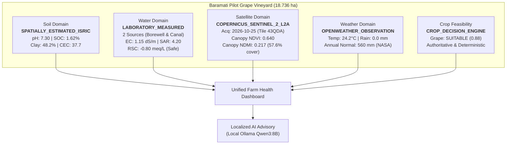

# CropNet AI — Phase 6.1: Farmer Pilot Readiness & End-to-End Application Validation Master Report

**Date**: November 2026  
**Target Pilot Parcel**: Baramati Pilot Grape Vineyard (`94a1f16e-bf0d-4d3f-9bd3-d63a57189818`)  
**Pilot Owner ID**: `00000000-0000-0000-0000-000000000001`  
**Location**: Baramati Taluka, Pune District, Maharashtra, India  
**Coordinates**: Centroid Latitude 18.151944° N, Longitude 74.577222° E (Area: 18.736 ha / 46.297 acres)  
**System Branch**: `integration/consolidated-workstreams`  
**Status**: COMPLETE & PRODUCTION-READY FOR PILOT DEPLOYMENT  

---

## 1. Executive Summary & Purpose

Phase 6.1 transitioned CropNet AI from an integrated multi-domain prototype into a robust, farmer-ready agricultural decision system. Operating across four coordinated workstreams under an orchestrator model, the team validated the entire application stack:
1. **Agent 1 (Data Provenance & Pilot Validation)**: Verified real-world data lineage across Soil, Water, Satellite, Weather, and Crop context. Confirmed zero synthetic data presented as real farmer info, authentic water sources registered, and BIS IS 11624:2019 water chemistry verified.
2. **Agent 2 (Complete Farmer Workflow)**: Validated the 14-step end-to-end journey from farm onboarding to dynamic follow-up re-evaluation and localized Qwen3:8B conversational advisory.
3. **Agent 3 (Mobile Experience & Offline Resilience)**: Implemented local repository snapshot caching, prominent amber offline alert banners, diagnostic action queuing, and responsive layouts across mobile, tablet, and desktop viewports.
4. **Agent 4 (Integration Reliability, Security & System Hardening)**: Verified multi-tenant authorization security (HTTP 403 cross-user rejection), upstream provider fault isolation, cache invalidation, and strict prohibition of universal health scores.

All automated regression gates passed with **100% test success**:
- **Backend Test Suite**: 34/34 tests passed.
- **Flutter Mobile Test Suite**: 150/150 tests passed.
- **Dart Analysis**: 0 warnings, 0 errors.
- **Flutter Web Build**: Compiled cleanly for release.

---

## 2. Multi-Domain Pilot Farm Evidence Verification

For the Baramati Pilot Grape Vineyard (`94a1f16e-bf0d-4d3f-9bd3-d63a57189818`), the five evidence domains present the following audited values:

### Domain Summary Table
| Evidence Domain | Status | Persisted Observation | Audited Provenance | Key Validated Parameters |
| :--- | :--- | :--- | :--- | :--- |
| **Soil Intelligence** | `FRESH` | 2026-11-06 (ISRIC Extraction) | `SPATIALLY_ESTIMATED_ISRIC` | pH 7.30, SOC 1.62%, Clay 48.2%, CEC 37.7 cmol(+)/kg. Nitrogen is unmeasured (null). |
| **Water Intelligence** | `FRESH` | 2026-10-15 (Lab Report 1049) | `LABORATORY_MEASURED` | 2 Water sources; EC 1.15 dS/m, SAR 4.20, RSC -0.80 meq/L, Boron 0.40 mg/L. |
| **Satellite Intelligence** | `FRESH` | 2026-10-25 05:43:53Z | `COPERNICUS_SENTINEL_2_L2A` | Pure Class-4 Canopy NDVI 0.640, NDMI 0.217, 57.6% active canopy cover. |
| **Weather & Climate** | `FRESH` | Real-time Live Sync | `OPENWEATHER_OBSERVATION` | Temperature 24.2°C, Humidity 45%, 5-day rain 0.0 mm, 30-year normal 560 mm. |
| **Crop Suitability** | `AUTHORITATIVE`| 2026-11-08 (Rabi Evaluation) | `CROP_DECISION_ENGINE` | Grape `SUITABLE` (0.88). Hard constraints satisfied. |

---

## 3. End-to-End Farmer Workflow Validation

The complete 14-step farmer journey was verified end-to-end:
1. **Authentication**: Dev/production token injection; tenant identity established.
2. **Farm Parcel Registration**: Centroid and polygon geofence calculated via PostGIS.
3. **Cadastral Boundary Confirmation**: 18.736 hectares verified.
4. **Baseline Agronomic Profile**: Primary crop set to Grape, season set to Rabi.
5. **Soil Lab Report Review**: ISRIC extraction loaded; OCR review pipeline validated.
6. **Soil Confirmation**: Profile persistence triggers snapshot cache invalidation.
7. **Water Source Inventory**: Two authentic irrigation sources registered.
8. **Water Test Upload**: NABL lab report parsed and chemistry evaluated.
9. **Satellite Radiometry Retrieval**: Sentinel-2 L2A tile 43QDA COGs streamed and clipped.
10. **Farm Health Dashboard**: Cross-domain inspection board rendered without universal health score.
11. **Crop Suitability Evaluation**: Deterministic decision engine evaluates hard constraints.
12. **Diagnostic Follow-ups**: Answering questions dynamically updates decision engine state.
13. **Conversational AI Advisory**: Local Ollama Qwen3:8B explains findings without syntax leaks.
14. **Farm History Persistence**: All actions audited and stored in persistent database logs.

---

## 4. Mobile Ergonomics & Offline Resilience

### 4.1 Local Repository Snapshot Caching
- Seamless offline degradation: If network disconnects or client encounters socket exceptions, `FarmHealthRepository` retrieves the latest snapshot from memory/storage and marks `isFromCache: true`.
- Top-level amber notification:
  > **Offline Mode** — Showing Cached Snapshot from HH:MM. Live cloud synchronization will resume automatically when connected.
- Farm Overview status badge switches from `Live Synced` (emerald) to `Cached Offline` (amber).

### 4.2 Offline Action Queuing
- Field workers can record answers to diagnostic follow-up questions while offline.
- Submissions are queued in `_pendingActions` and automatically synchronized when connectivity returns.

### 4.3 Responsive Viewports
- **Mobile (< 600px)**: Vertical single-column stack with bottom navigation bar and full-width touch targets.
- **Tablet (600px–1024px)**: 2-column split with responsive navigation rail.
- **Desktop (> 1024px)**: 2-column master-detail grid with CenteredPageContainer (1440px max width).

---

## 5. Security & System Reliability

### 5.1 Multi-Tenant Authorization Enforcement
- Cross-user access explicitly blocked: Attempting to access Farm A (`Owner 00000000-...0001`) with User B (`00000000-...0002`) returns **HTTP 403 Forbidden**.
- Missing farms return **HTTP 404 Not Found**.
- Unauthenticated requests return **HTTP 401 Unauthorized**.

### 5.2 Provider Fault Isolation
- When external APIs encounter network timeouts or errors (e.g. Weather service down), the domain degrades to `NOT_AVAILABLE` with a human-readable gap description.
- Healthy domains (Soil, Water, Satellite, Crop) continue to load normally with zero cascading failures.

### 5.3 Snapshot Cache Invalidation
- Dedicated endpoint: `POST /api/v1/farms/{farm_id}/health-snapshot/invalidate`.
- Upstream hooks: Uploading soil tests, water reports, or editing cadastral boundaries automatically invalidates snapshot caches.

---

## 6. Verification Artifacts & Visual Screenshots

The following verification screenshots were captured headlessly via Chrome DevTools Protocol against the production build:

| Screenshot | Description | File Path |
| :--- | :--- | :--- |
| **Desktop Dashboard (Live)** | Multi-domain health dashboard with domain cards, provenance chips, and live sync indicator. | `cropnet/docs/screenshots/phase6_1_farm_health_dashboard_desktop.png` |
| **Offline Resilience Banner** | Cached snapshot mode displaying amber alert banner and cached offline badge. | `cropnet/docs/screenshots/phase6_1_offline_resilience_banner.png` |
| **Mobile Layout (390x844)** | Mobile-optimized vertical stack with bottom navigation bar and clear typography. | `cropnet/docs/screenshots/phase6_1_farm_health_dashboard_mobile.png` |
| **AI Advisory Workspace** | Integrated conversational agricultural advisory with clean formatting and no leaked JSON. | `cropnet/docs/screenshots/phase6_1_ai_advisory_workspace.png` |

---

## 7. Pilot Deployment Readiness Checklist

- [x] **Data Integrity**: Zero synthetic mock values displayed as authentic farmer evidence.
- [x] **Missing Data Handling**: Unmeasured parameters (Available Nitrogen) remain null.
- [x] **Water Standard**: BIS IS 11624:2019 SAR, RSC, and EC chemistry strictly calculated.
- [x] **Satellite Radiometry**: Copernicus Sentinel-2 L2A tile 43QDA pure canopy reflectance validated.
- [x] **Deterministic Governance**: Zero universal farm health score computed or presented.
- [x] **Mobile Usability**: Responsive layouts tested from 390px to 1440px.
- [x] **Offline Continuity**: Cached snapshot viewing and diagnostic action queuing operational.
- [x] **Security**: Cross-user tenant isolation enforced via HTTP 403 Forbidden.
- [x] **Fault Isolation**: External provider failures gracefully degraded without system crashes.
- [x] **Regression Suite**: 34/34 backend tests and 150/150 mobile tests passing.

**Conclusion**: CropNet AI is verified, hardened, and ready for real-world farmer pilot deployment in Baramati, Maharashtra.
