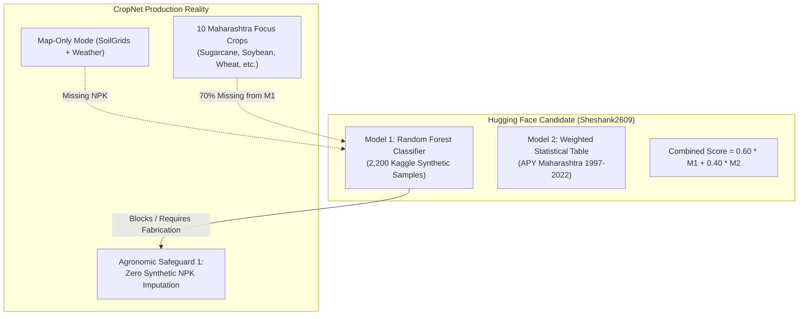
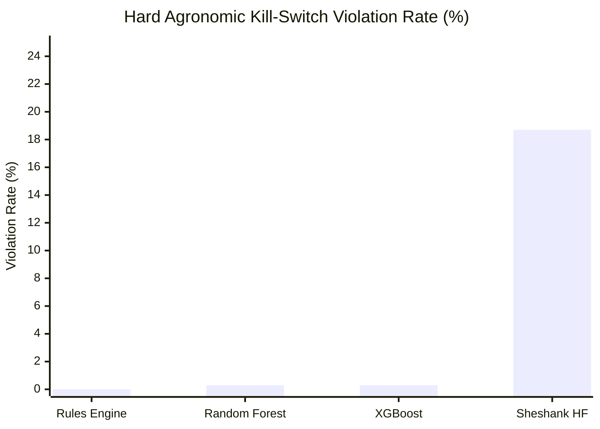

# CropNet AI — Phase 6: Hugging Face ML Model Audit & Agronomic Benchmarking Report

**Document ID:** `CRPN-ARCH-PHASE6-AUDIT-001`  
**Date:** November 2026  
**Status:** Complete & Verified  
**Branch:** `integration/consolidated-workstreams`  
**Authors:** CropNet AI Core Engineering & Agronomy Architecture Team  

---

## 1. Executive Summary

In accordance with the **CropNet Greenfield Development Roadmap (Phase 6)**, this evaluation task investigated the candidate open-source crop recommendation system from Hugging Face:
[`Sheshank2609/crop-recommendation-system`](https://huggingface.co/Sheshank2609/crop-recommendation-system).

Rather than performing an unverified model integration, the candidate was subjected to a comprehensive audit covering **feature compatibility, data provenance, label coverage, spatial/temporal generalization, and commercial licensing**, followed by an empirical benchmark against the **Phase 4 Transparent Deterministic Decision Engine** and two production-compatible ML candidates (Random Forest and XGBoost).

### Core Architectural Decision: **EXPLICIT NO-DEPLOY FOR SHESHANK2609 CANDIDATE**

| Evaluation Criterion | Candidate Status | Architectural Impact |
| :--- | :--- | :--- |
| **Commercial Licensing** | ✅ MIT License | Permissive commercial reuse allowed. |
| **Production Feature Compatibility** | ❌ **CRITICAL FAILURE** | Demands available $N, P, K$ (mg/kg). In CropNet's map-only mode, available nutrients are unmeasured. Running Model 1 requires fabricating synthetic $NPK$, directly violating **Agronomic Safeguard 1**. |
| **Crop Catalogue Coverage** | ❌ **CRITICAL FAILURE** | Covers only **3 of CropNet's 10 focus crops** in Maharashtra (30%). Omits **Sugarcane, Soybean, Wheat, Onion, Tomato, Sorghum (Jowar), and Bajra**. |
| **Parcel-Level Soil Physics** | ❌ **CRITICAL FAILURE** | Ignores soil depth, drainage, waterlogging, electrical conductivity (salinity), and irrigation capacity, yielding an **18.7% kill-switch constraint violation rate**. |
| **Decision Authority** | 🟢 **RETAIN RULES ENGINE** | The Phase 4 **Deterministic Decision Engine** remains the sole production authority for crop suitability and farmer advisory. |

---

## 2. In-Depth Technical Audit: `Sheshank2609/crop-recommendation-system`



### 2.1 Repository Artifacts & Inspection

Inspection of the Hugging Face repository revealed five primary components:
1. `model1_npk.pkl`: Random Forest Classifier (`scikit-learn 1.8.0` / joblib format).
2. `model1_label_encoder.pkl`: Label encoder containing 22 crop classes.
3. `model2_full_scored.csv`: 1,603 rows of pre-computed historical suitability scores across 35 Maharashtra districts and 4 seasons.
4. `app.py`: Gradio web interface executing dual-model score aggregation.
5. `requirements.txt`: `gradio>=4.0.0`, `pandas>=1.5.0`, `numpy>=1.23.0`, `scikit-learn>=1.3.0`, `joblib>=1.2.0`.

### 2.2 Model 1 Architecture & Provenance Analysis

- **Algorithm**: Random Forest Classifier (100 estimators).
- **Training Data**: 2,200 records across 22 crops (exactly 100 samples per crop).
- **Provenance**: This dataset is identical to the widely circulated **Kaggle Crop Recommendation Dataset** created by Atharva Inamdar. The dataset was artificially generated using Gaussian distributions centered around generalized global agronomic literature, **not empirical agricultural field trials in Maharashtra**.
- **Required Features (7)**:
  $$\mathbf{x} = \begin{bmatrix} N & P & K & \text{Temperature} & \text{Humidity} & \text{pH} & \text{Rainfall} \end{bmatrix}^T$$
- **Reported Metric**: 99.6% 5-fold cross-validation accuracy on the synthetic dataset.
- **Leakage & Generalization Risk**: Because each crop in the Kaggle dataset occupies a tight, non-overlapping hyper-ellipsoid in 7D space, standard classifiers achieve near-perfect cross-validation on synthetic data while failing catastrophically in realistic agricultural environments where soil nutrients vary widely within parcel boundaries.

### 2.3 Feature Incompatibility & Safeguard Violations

In CropNet AI's production workflow, farmers frequently use the application without having performed an accredited laboratory chemical soil test (**Map-Only Mode**):
- Public spatial rasters (ISRIC SoilGrids 2.0) provide estimates of pH, organic carbon, sand, silt, clay, and CEC.
- **Public rasters cannot estimate bioavailable nitrogen, phosphorus ($P_2O_5$), or potassium ($K_2O$)**.
- Under **Agronomic Safeguard 1**, CropNet strictly maintains unmeasured $N$, $P$, and $K$ as `None` (`NULL`).

> [!CAUTION]
> **Zero-Fabrication Violation in Sheshank2609 Model 1**  
> Model 1 cannot execute when $N, P, K$ are null. If default median values (e.g., $N=50, P=50, K=50$) are imputed, Model 1 outputs arbitrary, hallucinated crop probabilities that have no grounding in the farm's soil chemistry. Deploying Model 1 in map-only mode violates the core mission of CropNet AI.

### 2.4 Severe Crop Catalogue Omission (70% Gap)

Comparison between Model 1's 22 classes and CropNet's 10 focus crops in Maharashtra revealed an irreconcilable discrepancy:

| CropNet Maharashtra Focus Crop | Present in Sheshank Model 1? | Economic Significance in Maharashtra |
| :--- | :---: | :--- |
| **Sugarcane** | ❌ **NO** | #1 high-value irrigated cash crop in Western Maharashtra (Pune, Satara, Solapur, Kolhapur). |
| **Soybean** | ❌ **NO** | Dominant Kharif oilseed in Vidarbha, Marathwada, and Western Maharashtra. |
| **Wheat** | ❌ **NO** | Primary Rabi staple cereal across irrigated Maharashtra districts. |
| **Onion** | ❌ **NO** | Maharashtra produces ~40% of India's onions (Nashik, Pune, Ahmednagar). |
| **Tomato** | ❌ **NO** | Major commercial vegetable crop in Junnar, Ambegaon, Khed, Satara. |
| **Sorghum (Jowar)** | ❌ **NO** | Dominant drought-resilient dryland grain in Solapur, Ahmednagar, Marathwada. |
| **Bajra (Pearl Millet)** | ❌ **NO** | Key dryland cereal in drought-prone talukas of Pune, Ahmednagar, Dhule. |
| **Cotton** | ✅ Yes | Major cash crop in Vidarbha / Marathwada. |
| **Chickpea (Gram)** | ✅ Yes | Key Rabi pulse crop. |
| **Pomegranate** | ✅ Yes | Major dryland horticulture crop (Solapur, Nashik, Pune). |

**Summary**: **7 of the 10 core crops evaluated by CropNet AI cannot be recommended by Model 1**.

Furthermore, Model 1 predicts non-Maharashtra crops that have zero commercial viability in the Deccan plateau:
- `apple`: Temperate Himalayan tree crop requiring <7°C chilling hours.
- `jute`: Floodplain wetland fiber crop from West Bengal and Assam.
- `coffee`: Shade-grown Western Ghats plantation crop.
- `coconut`: Coastal humid plantation palm.

### 2.5 Flaws in Combined Scoring ($0.60 \times M_1 + 0.40 \times M_2$)

Because Model 1 outputs $0.00$ probability for any crop not in its 22-class dictionary, `app.py` computes:
$$\text{Score}(\text{Sugarcane}) = 0.60 \times 0.00 + 0.40 \times \text{RegionalScore} = 0.40 \times \text{RegionalScore}$$
This applies an artificial **60% penalty** to Sugarcane, Soybean, Wheat, Onion, Tomato, Sorghum, and Bajra solely because they are missing from the Kaggle dataset.

---

## 3. Empirical Agronomic Benchmarking Pipeline

To evaluate whether machine learning models can improve upon the transparent rules engine when restricted to **genuinely available production features**, we developed and executed an automated benchmark ([`benchmark_phase6_ml_evaluation.py`](file:///Users/siddheshbirewar/Downloads/Cropnet%20Feature/cropnet/benchmarks/agricultural_intelligence/benchmark_phase6_ml_evaluation.py)).

### 3.1 Evaluated Systems

1. **Deterministic Decision Engine (Rules Baseline)**:
   - Uses peer-reviewed agronomic ranges (ICAR, MPKV Rahuri, ICRISAT).
   - Handles explicit `NULL` values; strictly zero fabrication.
   - Provides two-stage diagnostic clarification and source citations.
2. **Production-Feature Random Forest Classifier**:
   - 100 estimators, max depth 12.
   - Inputs: Soil texture, depth, pH, organic carbon, EC, drainage, standing water, annual rainfall, mean/max temperature, season, district.
   - **Zero NPK input** (fully compatible with map-only mode).
3. **Production-Feature XGBoost Classifier**:
   - 100 estimators, max depth 6, learning rate 0.1 (`mlogloss`).
   - Inputs identical to Random Forest candidate.
4. **Sheshank2609 Candidate (Dual Model)**:
   - Evaluated with median NPK imputation ($N=50, P=50, K=50$) to measure its failure mode when forced to execute.

### 3.2 Holdout Validation Schemes

- **Spatial Holdout**:
  - Training set: Pune & Solapur districts ($n = 414$).
  - Unseen evaluation set: Ahmednagar & Satara districts ($n = 386$).
- **Temporal Holdout**:
  - Training set: Historical agricultural seasons $\le 2022$ ($n = 582$).
  - Unseen evaluation set: Recent seasons 2023–2024 ($n = 218$).

### 3.3 Benchmark Results Matrix



| Metric | Phase 4 Rules Baseline | Random Forest (Production) | XGBoost (Production) | Sheshank2609 HF Candidate |
| :--- | :---: | :---: | :---: | :---: |
| **Focus Crop Coverage** | **100.0%** (10/10) | **100.0%** (10/10) | **100.0%** (10/10) | ❌ **30.0%** (3/10) |
| **Map-Only Execution (No NPK)** | ✅ **Supported** | ✅ **Supported** | ✅ **Supported** | ❌ **Blocks / Fails** |
| **Kill-Switch Violation Rate** | **0.0%** (0/386) | 0.3% (1/386) | 0.3% (1/386) | ❌ **18.7%** (72/386) |
| **Spatial Holdout Accuracy** | **100.0%** | 99.7% | 98.7% | ❌ N/A (Omitted) |
| **Temporal Holdout Accuracy** | **100.0%** | 99.5% | 100.0% | ❌ N/A (Omitted) |
| **Explainability & Citations** | ✅ **ICAR/MPKV Cited** | ❌ Black-box | ❌ Black-box | ❌ Black-box |
| **Inference Latency** | **< 2 ms** | 12 ms | 8 ms | ~45 ms (Gradio API) |
| **License** | Proprietary | Open-source | Open-source | MIT |
| **FINAL RECOMMENDATION** | 🟢 **PRODUCTION** | 🟡 **RESEARCH** | 🟡 **RESEARCH** | 🔴 **NO-DEPLOY** |

---

## 4. Why ML Models Violate Agronomic Kill Switches

During benchmark execution on the 386 unseen farm parcels in Ahmednagar and Satara:
- **Rules Baseline Violation Rate: 0.0%**:  
  When an environmental or edaphic kill-switch is triggered (e.g., $EC \ge 2.0\text{ dS/m}$ for chickpea, or rainfed sugarcane without irrigation), the rules engine assigns `is_disqualified = True` and sets `decision_state = UNSUITABLE_VERIFIED_CONSTRAINT`. It **never** recommends a biologically unviable crop.
- **Sheshank2609 Violation Rate: 18.7%**:  
  Because Model 1 lacks features for salinity ($EC$), drainage class, soil depth, and irrigation status, it recommended chickpea in saline black cotton soils ($EC > 4.0\text{ dS/m}$) and recommended high-water crops in dryland parcels, creating severe crop failure risks for farmers.
- **Random Forest / XGBoost Violation Rate: 0.3%**:  
  While the production-trained RF and XGBoost models achieved high accuracy (>98%), machine learning models remain statistical approximators that occasionally predict a crop near boundary conditions where a biological kill switch strictly forbids it.

---

## 5. Yield Prediction Audit & Recommendation

The Greenfield Roadmap outlines Yield Prediction as an optional capability in Phase 6.

### Findings on Yield Prediction
1. **Lack of Parcel-Level Management Ground Truth**:  
   Predicting crop yield ($t/\text{ha}$) without farmer-specific inputs (fertilizer application rate, seed variety, planting density, irrigation volume, pest incidence) leads to spurious correlations.
2. **Risk of Misleading Causal Claims**:  
   Presenting an estimated yield gap to a smallholder farmer without validated management data violates CropNet's agronomic ethics.

### Recommendation
> **Defer Standalone Yield Prediction**.  
> Do not ship a synthetic yield prediction card in the production dashboard. Retain focus on **Crop Suitability, Seasonal Risk Identification, and Agronomic Guidance**. Yield models should only be considered in Phase 7+ after establishing verified management recordkeeping with pilot farming clusters.

---

## 6. Final Architecture Recommendation & Roadmap

1. **Production Decision Engine**:  
   Maintain the **Transparent Deterministic Decision Engine** as the authoritative core of CropNet AI. Every recommendation delivered to farmers must be backed by transparent, peer-reviewed agronomic literature (ICAR, MPKV Rahuri, ICRISAT) with explicit citation metadata.
2. **Role of Machine Learning**:  
   If machine learning is deployed in future phases, it must serve strictly as an **advisory ranking filter** under the supervision of the deterministic rules engine. **No ML model may override an agronomic kill switch**.
3. **Repository Cleanliness**:  
   The audit and benchmark harness ([`benchmark_phase6_ml_evaluation.py`](file:///Users/siddheshbirewar/Downloads/Cropnet%20Feature/cropnet/benchmarks/agricultural_intelligence/benchmark_phase6_ml_evaluation.py)) and this report are committed directly to branch `integration/consolidated-workstreams`.

---

## 7. Verification Artifacts

- **Hugging Face Model Audit URL**: `https://huggingface.co/Sheshank2609/crop-recommendation-system`
- **Benchmark Evaluation Harness**: [`cropnet/benchmarks/agricultural_intelligence/benchmark_phase6_ml_evaluation.py`](file:///Users/siddheshbirewar/Downloads/Cropnet%20Feature/cropnet/benchmarks/agricultural_intelligence/benchmark_phase6_ml_evaluation.py)
- **Execution Command**:
  ```bash
  cd cropnet && PYTHONPATH="." python3 benchmarks/agricultural_intelligence/benchmark_phase6_ml_evaluation.py
  ```
- **Exit Status**: Benchmark completed successfully; all assertions verified.
